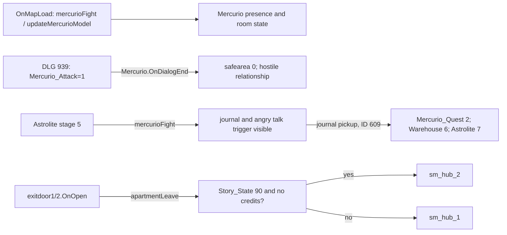

# SM-16.03 — Интерпретация и открытые вопросы

Граф показывает условные вызовы исходников. [INF] Квартира функционирует как повторно посещаемый узел: при изменении `Story_State`, исхода с Mercurio и состояния Carson одна и та же геометрия получает разную популяцию и набор предметов. Это интерпретация кода `finishElysiumTip`, `updateMercurioModel`, `mercurioFight`, а не заявленное намерение авторов.

[INF] Центральный подход с двумя боковыми зонами сначала концентрирует внимание на Mercurio, а затем может направить к компьютеру Carson и вещам по боковым комнатам. Пространственная возможность такого чтения подтверждена геометрией; фактическая последовательность посещений и доступность каждой комнаты требуют проверки дверных состояний. [INF] Два варианта выхода показывают, что даже выход из знакомой квартиры зависит от глобального сюжета, без перестройки самой карты.

## Состояния и события квартиры

Условия относятся к отдельным веткам. До проверки условий Carson и очистки `finishElysiumTip()` при `G.Elysium_Tip==1` ставит его в 2 и восстанавливает `G.Story_State` из `G.Story_State_Save`.

| Условие | Вызов / событие | Подтверждённый эффект | Источник | Остаётся непроверенным |
| --- | --- | --- | --- | --- |
| При выполнении DLG ID 1 или 121 | `mercurio.dlg` | ID 1 задаёт журнальный `Mercurio=2`; ID 121 — `G.Mercurio_Quest=1` и журнальный `Astrolite=1` | DLG 1, 121 | Приоритет стартовых условий и достижимость конкретной реплики |
| `pc.GetQuestState("Astrolite")==5` | `mercurioFight()` при загрузке | При наличии NPC меняет его модель и disposition; запускает телепорт и расписание, включает angry trigger и показывает journal с маркером | PY L120–137; VMF L31314 | Фактическая постановка и доступность объектов в игре |
| Подбор journal и `G.Mercurio_Quest<2` | `OnPlayerPickup → journalPickup()` | Журнал заданий получает `Warehouse=6`, `Astrolite=7`; `G.Mercurio_Quest=2`. VMF отдельно задаёт `G.Journal_Taken=1` при подборе | VMF ID 609, L33602–33611; PY L68–74 | Возможность подбора в конкретном состоянии |
| Смерть Mercurio; отдельно `Astrolite==5` | `OnDeath → mercurioDeath()` | `G.Mercurio_Dead=1`, safe area 1; только при этапе Astrolite 5 журнал получает `Astrolite=6` | PY L101–109; VMF ID 514 | Достижимость события при конкретных состояниях |
| `5<=G.Story_State<15` | `updateMercurioModel()` | Скрывает NPC при наличии | PY L76–80 | Фактическое состояние NPC при загрузке |
| `G.Story_State>=15 && G.Prince_Mercurio==0` | `updateMercurioModel()` | Показывает и меняет модель NPC при наличии, запускает телепорт и расписание | PY L81–89 | Проходимость и фактическая постановка |
| Ветка `elif G.Prince_Mercurio` после невыполненного предыдущего условия | `updateMercurioModel()` | Удаляет NPC при наличии | PY L81–91 | Фактическая достижимость ветки в выбранном прохождении |
| `G.Patch_Plus==1 && G.Carson_Rescued==1` | `finishElysiumTip()` | Удаляет найденные компьютер, плакат, плеер и магнитофон Carson | PY L44–52 | Наличие каждого объекта при вызове |
| `G.Story_State>=15 && G.Patch_Plus==1 && G.Level_Clean==0` | `finishElysiumTip()` | Удаляет найденные кровавые объекты, показывает чистые диван и стол, ставит `G.Level_Clean=1` | PY L53–66 | Вид и коллизии после смены объектов |
| Текущий этап журнала `Arthur Knox` больше 0 и меньше 2 | `carsonComputerHacked()` | Записывает в журнал `Arthur Knox=2` | PY L31–36; Carson_Computer.txt | Доступ к терминалу в конкретном состоянии |
| `G.Story_State==90 && G.Credits_Running==0`, иначе другая ветка | `exitdoor1/2.OnOpen → apartmentLeave()` | `ChangeMap` с `ApartmentTeleport2`, иначе с `ApartmentTeleport1` | PY L24–29; VMF ID 481/483 и changelevel ID 617/511 | Фактическое выполнение перехода в игре |

## Проверки, оставленные после статического исследования

1. **RUNTIME:** проходимость из центрального подхода в обе боковые зоны, коллизия дверей и условия электронных ручек; нужен движковый тест/BSP-коллизия. План показывает геометрию и сущности, не гарантированный путь.
2. **RUNTIME:** приоритет пересекающихся стартовых условий 1007–1026, группировка ответов и фактическая достижимость поздних DLG-веток; нужен диалоговый движок или наблюдение в игре.
3. **TARGET_NOT_FOUND_IN_CHECKED_SOURCES:** `sm_hub_2.vmf` L143637–143643 содержит скрытый `ApartmentTeleport1_plus → sm_apartment_1b`. Целевая BSP не найдена в loose-каталогах `Unofficial_Patch/maps`, `Vampire/maps` или индексах 18 `Vampire/pack*.vpk`. Условия активации и результат перехода — UNVERIFIED; сам факт отсутствия в проверенных источниках подтверждён статически.
4. **RUNTIME:** `mercurioCamera()` при `Story_State>5` или журнальном `Astrolite==5` вызывает `pc.SetCamera("DialogDefault")` (PY L93–99). VMF L31296 вызывает функцию при `Mercurio.OnDialogBegin`; фактический кадр и его постановка остаются UNVERIFIED.

**Статус: SOURCE COMPLETE / RUNTIME PENDING.** Основные доступные VMF, BSP entity lump, Python, DLG и DATA для Apartment исследованы и связаны. В игре [OBS] не проверялось.
