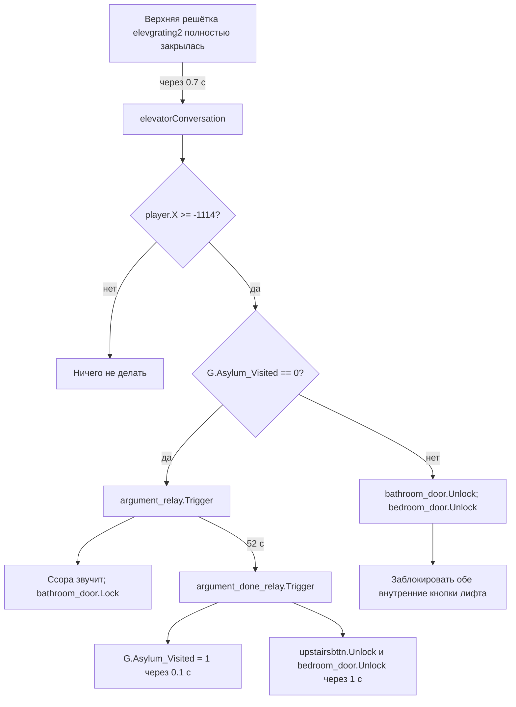

# SM-13.05 — Asylum: Python, состояния квестов и синхронизация с VMF

> [!important] Доказательная база
> **VERIFIED_STATIC** ([F:PY], [F:VMF], [F:2]) относится к указанным строкам установленного Python, SDK VMF и отмеченным совпадениям в установленном BSP entity lump. **INFERRED** ([I]) — интерпретация. **UNVERIFIED** ([?]) — поведение движка и фактическое выполнение в игре. Хеш исторического Python сохранён для идентификации SOURCE_MISMATCH.
>
> Продолжение: [[SM-13_Asylum_00_Index]], [[SM-13_Asylum_01_Spatial]], [[SM-13_Asylum_02_Entities]], [[SM-13_Asylum_03_Logic]], [[../../../../02_Analysis/SM-13_Asylum_04_Analysis]]. **Никакого проектирования ремейка.**

## 1. Область анализа

`worldspawn.levelscript="santamonica"` в VMF; в `santamonica.py` найдено **12 функций с явным комментарием `#ASYLUM`** (`PY L162–388`). Это общий скрипт нескольких локаций, поэтому остальные функции нельзя автоматически считать уникальными для Asylum.

| Функция / PY | Назначение, подтверждённое кодом | Вызывается в VMF |
|---|---|---|
| `calDialog` (163–166) | Разблокировать `downstairsbttn`, если `Cal_Permission==1` | `OnMapLoad`, `Cal.OnDialogEnd` |
| `checkElevatorPermission` (169–174) | Включить/снять блокировку `downstairsbttn` | `elev_counter_downstairs.OnHitMax` |
| `chunkDancing` (177–182) | Вызвать `ScriptUnhide` или `ScriptHide` для Chunk | `OnMapLoad` |
| `danielleDialog` (185–189) | При комбинации флагов Vandal/Patty/Gimble изменить общение Danielle | `Danielle.OnDialogEnd` |
| `elevatorConversation` (192–212) | Проверка X игрока; старт ссоры либо разблокировка комнат | `elevgrating2.OnFullyClosed` |
| `knoxPresence` (215–238) | После первого визита выбрать вариант Knox при выполнении условий, обработать Danielle/Doll1 и вызвать `Cal.WillTalk(1)` | `OnMapLoad` |
| `jeanetteDialog` (241–245) | Запустить `jeanette_boink_relay`, перевести флаг 1→2 | `Jeanette.OnDialogEnd` |
| `jeanetteDownstairs` (248–265) | Условный перенос вниз и включение триггера с реле. В альтернативной ветке возможен `Kill` реле | `OnMapLoad` |
| `jeanetteGoesUp` (268–273) | При условии перенести Jeanette вверх и скрыть | `Cal.OnDialogBegin` |
| `populateOffice` (276–370) | Восемь приоритетных веток состояния трёх NPC, ПК и триггеров | `OnMapLoad` |
| `touretteDialogueResults` (373–383) | Постсцена: затемнение и смена модели или переход на `asylum1` | `Tourette.OnDialogEnd` |
| `touretteMuzzleFlash` (386–388) | Включить `muzzle_flash` | **Прямого I/O-вызова в VMF не обнаружено** |

В `asylum_script_io_crossrefs.csv` приведены номера строк конкретных выходов SDK VMF и определений Python. Все 12 отмеченных прямых выходов сверены с установленным BSP entity lump по `output` и строке подключения.

**[F:VMF]** Сопоставление строк показало, что имена локальных сущностей, к которым обращаются эти 12 функций через буквальный `Find("…")`, присутствуют в VMF. Это проверка ссылок, **не** проверка корректности выполнения каждого метода движком.

## 2. Доступ к лифту: флаг Cal не равен разрешению от дверей

**[F:2]** Кнопка у нижней остановки `downstairsbttn` имеет в VMF `locked=1` (`VMF L41691`), а верхняя `upstairsbttn` — `locked=0` (`L41722`). На загрузке и после окончания беседы с Cal вызывается `calDialog()`: **только** если `G.Cal_Permission == 1`, нижняя кнопка получает `Unlock()` (`PY L163–166`, `VMF L38805`, `L38820`).

**[F:2]** После закрытия шести створок нижней группы счётчик `elev_counter_downstairs` достигает max=6 (`VMF L42167`), вызывает `checkElevatorPermission()` (`PY L169–174`) и повторно ставит кнопку в `Lock` или `Unlock` в зависимости от **того же флага**. Следовательно, разрешение Cal проверяется как минимум в двух контекстах: загрузка/диалог и цикл лифтовых дверей.

**[F:DLG]** `Cal.dlg` ID 101, 111, 121 и 281 присваивают `G.Cal_Permission = 1`. Подробности в [[../../Characters/SM-13_Asylum_06_Cal_Dialogue]]. Игровой приоритет способов допуска остаётся UNVERIFIED.

## 3. Первая ссора сестёр: цепочка полностью найдена

**[F:2]** В `VMF L28676` дверь `elevgrating2` (верхняя решётка лифта, `origin=-1113.5 606 38`) на `OnFullyClosed` через **0.7 с** вызывает `elevatorConversation()`.

Условие координат и ветки — `PY L192–212`. Запуск и звуковое событие — `VMF L41347`; завершение — `VMF L42665`.

**Важные тонкости:**

1. **52 и 55 секунд — разные механизмы.** `argument_relay` вызывает `argument_done_relay` через 52 с; Python параллельно планирует `G.Asylum_Visited=1` через **55 с** (`PY L199`). Завершающее реле само тоже устанавливает этот флаг через 0.1 с. Их нельзя ошибочно считать одной задержкой.
2. **Ванная ≠ спальня по механизму открытия.** Первый запуск сразу `bathroom_door.Lock`, а через 52+ секунд `argument_done_relay` разблокирует **`bedroom_door`**, но **не** `bathroom_door` (`VMF L41347`, `L42665`). В показанной Python-функции разблокировка ванной присутствует **в повторной ветке**, когда `Asylum_Visited != 0` и `X >= -1114`. Прямого VMF-события `bathroom_door.Unlock` в файле не найдено. Доступность ванной сразу после ссоры **не доказана**.
3. **Условие X, вероятно, отсеивает игрока внутри шахты/кабины** [I]: решётка расположена при `X=-1113.5`; если игрок ещё находится левее `X=-1114`, при закрытии разговор не стартует. Для подтверждения такой пространственной интерпретации нужен просмотр конкретного расположения игрока/коллизий [игра/BSP].
4. **Возможность повторного старта до установки флага** есть на уровне условий: сама функция не выставляет флаг синхронно перед запуском, а откладывает его. Будет ли повторно вызвано `OnFullyClosed` за этот интервал — **не доказано**, поэтому считать это багом нельзя.
5. `upstairsbttn` в свойствах VMF первоначально `locked=0`; позже самоблокируется при использовании и разблокируется несколькими путями (в том числе `argument_done_relay`, `elev_counter_upstairs`). Нельзя утверждать, что именно ссора впервые открывает верхнюю кнопку.

## 4. Первое знакомство с Jeanette и лифтовая постановка

**[F:2]** На загрузке `jeanetteDownstairs()` проверяет `(Jeanette.times_talked == 0 or G.Jeanette_Know == 0) and G.Therese_Quest == 0` (`PY L248–265`). Перед проверкой функция вызывает `Jeanette.UseInteresting(0)`. Если условие истинно:

- переключает disposition Jeanette на `Flirtatious`;
- вызывает `bring_Jeanette_down.Teleport()`; точка переноса — `(-904.223, 420.837, -280.691)`;
- включает `Jeanette_dialog` и `wait_for_elevator_relay` (в VMF оба стартуют с `StartDisabled=1`).

Далее `Jeanette_dialog.OnStartTouch` запускает разговор с задержкой 1 с (`VMF L39660`); `Jeanette.OnDialogEnd` вызывает `wait_for_elevator_relay.Trigger` и `jeanetteDialog()` (`VMF L38915` для Python; L38858 — начало блока сущности). Реле переключает камеру, контроллер игрока и запускает сцену ожидания лифта (`VMF L39343`). По дальнейшим I/O Jeanette оказывается у лифта и переносится наверх через `bring_Jeanette_up`, при этом применяется `ScriptHide` (`VMF L41449`).

**[F:PY]** Если первое-знакомство-условие **не** выполнено, `jeanetteDownstairs()` включает `UseInteresting(1)` на `jeanette_flirt_partner` и вызывает `Kill()` на `wait_for_elevator_relay` при наличии; положение Jeanette из этой ветки само по себе не определяется.

**[F:2]** `Cal.OnDialogBegin → jeanetteGoesUp()`: если `G.Cal_Permission != 1` **или** `G.Therese_Quest == 0`, Jeanette переносится наверх и скрывается (`PY L268–273`). Это независимая от сцены ожидания лифта ветка. В каком порядке реальные диалоги допускают её выполнение — проверять по DLG.

**[F:2]** После диалога Jeanette, когда `G.Jeanette_Boink == 1`, `jeanetteDialog()` активирует отдельное `jeanette_boink_relay` и переводит флаг в `2` (`PY L241–245`); relay инициирует fade/аудио/контроллер и возвращает Jeanette через 35 с (`VMF L42122`). Условие получения `Jeanette_Boink == 1` находится **не в данном Python**.

## 5. populateOffice(): действительный порядок условий

**[F:PY]** Функция (`PY L276–370`) — приоритетная цепочка `if / elif`, а **не** независимая таблица одновременно действующих правил. Вывод ниже показывает действия выбранной ветки **до** иных I/O или диалогов. `Show`/`Hide` означает вызовы `ScriptUnhide`/`ScriptHide` на сущностях, а не гарантированную итоговую видимость в кадре.

| № / строки | Условие (проверяется только после отказа предыдущих) | Показаны / скрыты | Дополнительный эффект |
|---|---|---|---|
| 1, L286–294 | `Therese_Quest < 2` | `Jeanette_Know==1`: только Therese; иначе **Jeanette и Therese одновременно**; Tourette скрыта | Не меняет ПК-блокеры явно |
| 2, L295–301 | `2 ≤ Therese_Quest < 3`, `Jeanette_Quest < 2`, `Jeanette_Refuse < 1` | Jeanette видна, Therese/Tourette скрыты | Jeanette PC blocker виден, Therese blocker скрыт; `Jeanette.UseInteresting(1)` |
| 3, L302–308 | `Jeanette_Quest == 2` и `Therese_Quest < 4` | Therese видна; остальные скрыты | Therese PC blocker виден; `Therese_mad_trigger.Enable` |
| 4, L309–315 | `3 < Hotel state < 6` и `Slashterpiece state == 0` | Therese видна; остальные скрыты | Аналогично ветке 3 |
| 5, L316–321 | `Jeanette_Refuse ≥ 1`, `Jeanette_Fire < 3`, `Therese_Quest < 3` | Все три скрыты | Оба ПК-блокера скрыты |
| 6, L322–328 | `Jeanette_Fire == 3`, `Therese_Quest < 4` | Therese видна; остальные скрыты | `Therese_mad_trigger.Enable` |
| 7, L329–338 | `Therese_Quest == 4`, нет `Tourette_Wins`, `Therese_Dead`, `Jeanette_Dead` | Tourette видна; Jeanette/Therese скрыты | Показать оба ПК-блокера, включить `tourette_trigger` и вызвать `tourette_sequence_relay.Trigger()` |
| 8, L339–363 | `Tourette_Wins==1` **или** Therese/Jeanette dead | Если `Story_State < 10` — все скрыты; иначе победитель/выжившая по последовательным проверкам | ПК-блокеры меняются согласно подветке |
| 9, L364–367 | Ни один вариант | Сообщение `Unaccounted for case` | Нет явного переключения NPC |

**Критический пример приоритета [F:PY]:** `Therese_Quest == 4` **не гарантирует** появление Tourette. Если на том же входе `Hotel state==4` и `Slashterpiece state==0`, сработает **ветка №4**, потому что она стоит раньше ветки №7. Это нельзя терять при построении квестового графа.

**Особенность ветки 8:** при `Story_State >=10` проверяется сначала `Tourette_Wins`, затем `Jeanette_Dead`, затем `Therese_Dead`. Если одновременно истинны несколько флагов, первый подходящий вариант имеет приоритет. Статусы «выжил/умер» берутся из глобальных флагов; их условия установки — не в этой функции.

После выбора ветки при `Vandal_Quest==3`, `Patty_SM!=1`, `Gimble_Vandal!=1` код **дополнительно убивает/удаляет Danielle entity** (`L368–370`). Это не часть выбора трёх вампиров.

## 6. Tourette: развязка и смена модели

**[F:2]** Ветка №7 `populateOffice()` показывает Tourette и включает `tourette_trigger`. VMF-триггер управляет камерой, анимациями оружия, видимостью револьвера и временным контроллером игрока (`VMF L39923–40080`). После диалога вызывается `touretteDialogueResults()` (`PY L373–383`).

- Если `G.Jeanette_Dead == 1`: запускается `asylum_fade`, через 3 с **модель сущности `Tourette`** меняется на `Therese.mdl`. Это **не** явное изменение `targetname`, `dialogname` или факт рождения нового NPC.
- Иначе, если `G.Tourette_Wins == 1`: удаляется `Tourette_thirtyeight` (при наличии) и вызывается `__main__.ChangeMap(2.5, "asylum1", "AsylumTeleport1")`.
- Если ни одно условие не истинно, функция не делает явных действий. Условия появления этой развязки определяются и диалогами.

**[F:PY]** `touretteMuzzleFlash()` включает `muzzle_flash` (`PY L386–388`). В VMF объект `muzzle_flash` есть (`L41878`), но обращения к функции в `connections` **нет**. Не следует считать эффекты выстрела нерабочими: вызов может находиться в DLG/другом сценарии.

## 7. Второстепенные NPC и версии Plus

**[F:PY]** `knoxPresence()` (`PY L215–238`) сразу возвращается при `G.Asylum_Visited == 0`. Затем при `G.Mercurio_Quest >= 2` и ложном `IsDead("Knox")` выбирает `Knox_plus` при `G.Patch_Plus == 1`, иначе `Knox_basic`. При наличии сущности вызывает `ScriptUnhide()` и `SetName("Knox")`. После этой проверки отдельно обрабатывает `Danielle_Dead` / `Doll1_Dead` (L230–236) и вызывает `Cal.WillTalk(1)` (L237–238). Ветка `else: doll1.WillTalk(1)` записана буквально под `if doll1`. Реакция движка на отсутствующий объект UNVERIFIED.

**[F:PY]** `chunkDancing()` (`PY L177–182`) вызывает `Chunk.ScriptUnhide()` при наличии сущности, `Chunk_Dominated == 2`, `Story_State < 10`, `Chunk_Dead == 0` и ложном `IsDead("Chunk")`. В альтернативной ветке записан `chunk.ScriptHide()`. `Danielle.Kill()` и `Doll1.Kill()` по флагам смерти находятся в `knoxPresence()`. Независимый вызов `Danielle.Kill()` по квестовым флагам находится в `populateOffice()`.

**[F:PY]** `danielleDialog()` (`L185–189`) при `Vandal_Quest==3`, `Patty_SM!=1`, `Gimble_Vandal!=1` вызывает `UseInteresting(1)` и `WillTalk(0)` для Danielle. `populateOffice()` при тех же условиях может вызвать `Danielle.Kill`; их фактическое сочетание во времени нужно проверять, а не автоматически объявлять ошибкой.

**[F:2]** `logic_auto.OnMapLoad` содержит `unhidePlus()` (VMF L46562, также BSP). Реализация `Unofficial_Patch/python/vamputil.py:25–32` планирует вызов `c.patchtype` и для кланов 9/10/11 задаёт `c.vskip_intro`. Движковые эффекты команд остаются UNVERIFIED.

## 8. Доказуемые перекрёстные связи других карт

Эти факты — из **того же** `santamonica.py`, но относятся к вызовам на **других локациях**, которые пока не сопоставлены с их VMF:

| Другая локация / функция | Проверенный эффект | Что это значит для Asylum |
|---|---|---|
| Ocean House, `oceanhouseQuestComplete` (`PY L1465–1467`) | `SetQuest("Hotel",2)`; `G.Therese_Quest=2` | Объясняет один внешний источник перехода в поздние ветки `populateOffice` |
| Diner, `thugsAllDead` (`PY L1220–1239`) | Если `Therese_Quest !=4`, выставляет `G.Therese_Quest=4`, `SetQuest("Diner",2)`, включает звонок | Переход к потенциальной ветке Tourette зависит от события в **другой карте**, а не только Asylum |
| Santa Monica hub, `bertramOutOfHiding` (`PY L1761–1825`) | Реагирует на `Tourette_Wins`, `Therese_Dead`, `Jeanette_Dead` и открывает связанную реакцию Bertram | Исход развязки имеет следствие вне Asylum (точная точка вызова ещё не проверена) |
| Santa Monica hub, `jeanetteRefused` (`PY L1975–2029`) | Использует `Jeanette_Quest`, `Jeanette_Refuse`, `Gallery_Slashed` и другие флаги | Решения/состояния Jeanette связаны с событиями Gallery/улицы; точная сценарная последовательность требует исходники hub/DLG |
| Santa Monica hub, `knoxState` (`PY L2044–2057`) | При `Mercurio_Quest==2` или смерти Knox удаляет его entity из hub | Дополняет `knoxPresence`: NPC может быть убран из одной карты и показан в Asylum в зависимости от флагов; это пока **не** доказательство его маршрута в игровом мире |

**[I]** Таким образом, Asylum выступает *визуализатором глобального состояния прохождения*: его локальная популяция не хранит всю квестовую причинность внутри одной карты. Python содержит проверяемые последствия, но причины многих флагов лежат в DLG.

## 9. Неожиданная находка: записка Voerman связана с Serial

**[F:2]** VMF: `voerman_note` (`VMF L41417` (выход `OnReadBegin`)) вызывает на `OnReadBegin` **`murderPaperRead()`**. В `santamonica.py` функция расположена в разделе `#HAVEN` (`PY L1383–1387`) и при `GetQuestState("Serial")==0` и `Story_State<5` выставляет `SetQuest("Serial",1)`.

Это **прямое сцепление** записки в Asylum с функцией для газеты в Haven. **[?]** Нам неизвестно, приводит ли чтение записки к реальному обновлению квеста именно в игровой сборке: надо проверить движок/первоначальное состояние квеста. **Не называть багом без проверки.**

## 10. Открытые вопросы после изучения Python

| Приоритет | Что неизвестно | Минимальный источник |
|---|---|---|
| P0 | Как движок выбирает ветку допуска Cal при перекрывающихся стартовых условиях | Игровая проверка по [[../../Characters/SM-13_Asylum_06_Cal_Dialogue]] |
| P0 | Runtime-порядок DLG, Python и событий карты при развязке | Сценарии по исследованиям Jeanette, Therese и Tourette из [[SM-13_Asylum_00_Index]] |
| P1 | Доступ в ванную непосредственно после окончания 52-секундной ссоры без нового цикла верхней решётки | Точечная игровая проверка или полная трассировка DLG/движка |
| P1 | Кто вызывает `touretteMuzzleFlash()` и какие действия сопровождают выстрел | `Tourette.dlg` / дополнительные сценарии |
| P1 | Фактический эффект `c.patchtype` и `c.vskip_intro` в данной конфигурации | Движок / контролируемая игровая проверка |
| P2 | Читается ли `voerman_note`, когда `Serial` state равен 0, и меняет ли квест | Прицельная игровая проверка |
| P2 | Какие физические позиции/коллизии реально обеспечивают условие X при закрытии лифтовой решётки | BSP или игровая проверка |

Измерения runtime требуют начальных флагов, маршрута и наблюдаемого результата.
