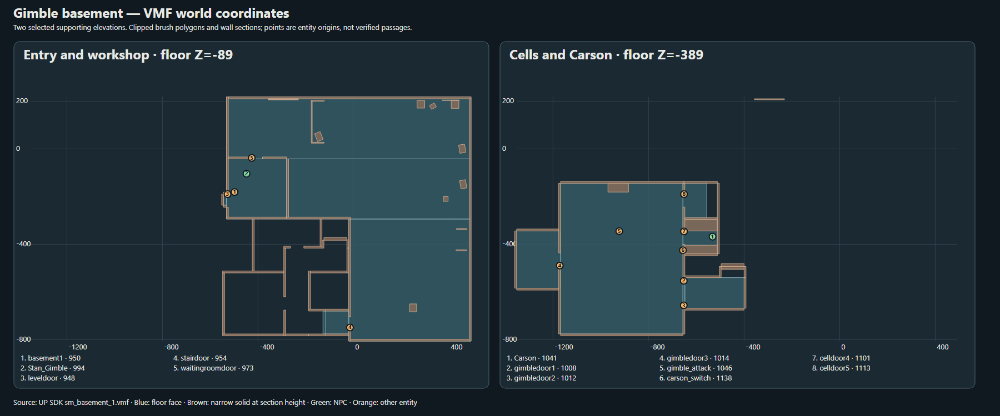

# SM-18 — пространство и уровни

[SVG](SM-18_Basement_Assets/SM-18_Basement_Levels.svg) · [PNG](SM-18_Basement_Assets/SM-18_Basement_Levels.png). Синим показаны реальные горизонтальные полигоны граней брашей после пересечения всех плоскостей, коричневым — узкие сечения стен на Z=−50/−350. Точки — `origin` сущностей, **не доказанные проходы**.

## Геометрические опоры

| Узел | Основание | Вывод |
|---|---|---|
| Входной уровень | [VMF] solid 736/side 4458 Z=−89, X=−532…492, Y=−42…218; solid 737/side 4464 X=−532…−280, Y=−294…−42; solid 738/side 4470 X=−280…492, Y=−294…−42; solid 15/side 124 X=−20…492, Y=−806…−294 | Опорные области вокруг входа/мастерской. |
| Нижний уровень | [VMF] solid 794/side 4806 Z=−389, X=−1168…−656, Y=−776…−144; solid 802/side 4854 X=−1352…−1168, Y=−584…−344; solid 789/side 4776 X=−648…−400, Y=−668…−540; solid 824/side 4986 X=−656…−512, Y=−440…−292 | Области клеток и Carson. |
| Промежуточные высоты | [VMF] грани от Z=−329 до −149, например solid 775/side 4692, solid 746/side 4518. | [INF] Многоуровневая конструкция между −389 и −89; непрерывная лестничная траектория по этим граням не доказана. Высоты Z=39/112 не объявляются отдельным игровым этажом. |

## Двери и переходы

- [VMF] `leveldoor` ID 948 `(-527.5,-190,-35)`, OnFullyOpen → `BasementTeleport1.ChangeNow` (L15577). `BasementTeleport1` ID 951 ведёт в `sm_hub_1` через landmark `basement1` ID 950 `(-498,-181,-80)`.
- [VMF] `stairdoor` ID 954 `(-15,-749.02,-35)` стоит у южного края входной плиты. [INF] Дверь отмечает возможный подход к спуску; одно положение не доказывает сквозную проходимость.
- [VMF] Нижний уровень: `gimbledoor1` ID 1008 `(-652.5,-553,-335.5)` связан `linked_door` с `gimbledoor2` ID 1012 `(-652.5,-656,-335.5)`; оба отпирает `gimble_dead_relay` (L23164–65). `gimbledoor3` ID 1014 `(-1171.5,-489,-335.5)` отпирается веткой нападения либо веткой `G.Gimble_Vandal` (L18080, L23748).
- [VMF] `celldoor4` ID 1101 `(-651.5,-346,-335.5)` отпирается и открывается `carson_switch` ID 1138 по `OnDeactivate` (L23145–46); фактический проход игрока после анимации — [HYP].
- [VMF] `point_teleport` `gimble_teleport` `(-1252.53,-456.944,-380)` и `player_teleport` `(-858.12,-459.276,-380)` — сценарные переносы, не свободные коридоры.

## Граница схемы

[INF] Выделены две крупные опорные высоты и промежуточные грани; стены показаны сечениями. Схема не моделирует динамические двери, лестничные коллизии, мебель и навигационную сетку. Прямые линии между маркерами не рисуются: такой путь не доказан координатами.
