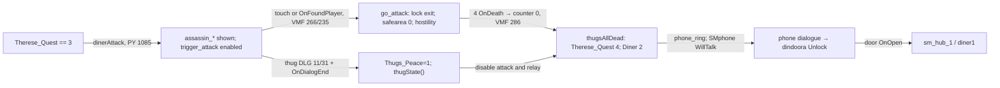

# SM-15.03 — Связи, интерпретация и вопросы

Граф показывает вызовы и условия локальных исходников, не симуляцию движка. В частности, `thugsAllDead()` может быть вызвана из `thugState()` без опустошения счётчика смертей. [INF] Это делает телефон и выход общим состоянием после двух технически различных разрешений конфликта. [INF] Размещение `trigger_attack` у дальней части зала `(679.5,224)` и NPC у западной стороны X≈−76…100 даёт пространственную ось напряжения; точную необходимость пересечь триггер для продвижения нельзя доказать одним origin.

[INF] Обычный зал, засада Therese и ранняя встреча с Killer используют одну карту с разной активной популяцией и безопасностью. `logic_auto` ID 280 запускает `lillyStuff()`, `killerInDiner()`, `dinerAttack()` при загрузке; это механизм повторного использования пространства, а не доказательство намерения разработчиков. [INF] Doris соединяет побочные сведения и Lily's purse с социальной обстановкой: её состояние меняет доступность NPC и предмета, но конкретные строки её диалога проверяются отдельно.

## Открытые вопросы

1. **RUNTIME:** фактическая проходимость между входом, залом, телефоном и выходом с учётом компилированной коллизии и блокирующих состояний `dindoora`.
2. **RUNTIME:** точный порядок оценки стартовых условий DLG и достижимость мирного ответа thug при конкретном состоянии игрока. Статические файлы и скрипт доказывают реализацию ветки, но не вероятность её выбора.
3. **CROSS-LOCATION:** предыдущее присваивание `Therese_Quest=3`, последствия телефонного разговора и последующие состояния Asylum должны рассматриваться совместно со `sm_hub_1` и Asylum; здесь доказаны локальные изменения и переход.
4. **OPTIONAL:** полное сравнение всех деталей VMF с компилированной BSP и всех изменений UP Plus с релизом 2004 года. Девять ключевых сущностей сверены выборочно.

**Статус: SOURCE COMPLETE / RUNTIME PENDING.** Основные локальные VMF/BSP/Python/DLG-цепочки и пространственная структура документированы; [OBS] отсутствует. Вопросы выше не превращают статический источник в доказанное поведение игры.
