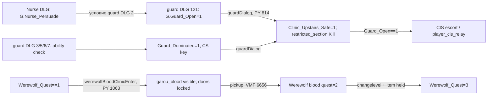

# SM-14.03 — Сценарные зависимости

Стрелки в графе обозначают **условные причинные связи исходников**, не наблюдавшийся гарантированный сценарий. [VMF] `clinic_guard.OnDialogEnd` вызывает `guardDialog()` (ID 5295, L58451), `Nurse.OnDialogEnd` — `nurseDialog()` (ID 5298, L58571), `Lily.OnDialogEnd` — `lilyDialog()` (ID 5293, L58312), `Vandal.OnDialogEnd` — `vandalDialog()` (ID 5294, L58379). [DLG] `clinic_guard.dlg` узлы 1/21/31 увеличивают `G.Guard_Warning`; [PY] при значении ≥3 применяется отложенная враждебность (L858–859), если не выполнена ветка разрешения.

## Начальные условия шести DLG [DLG]

`SM-14_Medical_Assets/SM-14_Dialogue_Rows.csv` содержит все 1401 нумерованных слотов с исходными полями 4–6 и **только явными** числовыми целями. Следующая таблица показывает стартовые слоты, не утверждая, что движок выбирает их в перечисленном порядке. Условия могут пересекаться; наличие реплики в файле не делает её доступной в конкретной игре.

| DLG | Стартовые слоты и условия | Существенные действия |
| --- | --- | --- |
| `clinic_guard` | 193 `Guard_Open==2`; 194 `Guard_Warning>2`; 195 `==2`; 196 `==1`; 197 Nosferatu; 198 первый разговор | 121 `Guard_Open=1`; 141 `Guard_CS=1`, `Guard_Open=1`; 3/5 Dominate/Dementation дают CS key; 6/7 требуют `Patch_Plus==1` для Thaumaturgy/Presence; 152 — seduction/feed и ключ. |
| `nurse` | 122–123 Nosferatu; 124 `Nurse_Flag==1`; 125 `Nurse_Safe==1`; 126/127 предупреждение 2/1; 128 повторный разговор; 129 не первый разговор | 31 `Nurse_Flag=1`, сброс предупреждений; 61 лестничный ключ + `Nurse_Persuade=1`; 71 ставит `Nurse_Warn=1`. |
| `malcolm` | 152/154 Nosferatu; 153 повтор; 155 первый разговор | 82 `Malcolm_Affair=4`; 83 при `Intimidate 3` ставит `Malcolm_Affair=5`. `heatherCheck()` по этим флагам показывает разные деньги только при `Patch_Plus==1` и живом Malcolm [PY L870–881]. |
| `phil` | 101 `Phil_Seduce==1 && Patch_Plus==1`; 102 `Phil_Asleep==1` или seduce; 103 persuasion/drop; 104 начало; 105 первый разговор | 31 `Phil_Persuade=1`; 32/33 условная награда опыта; 62/63 вызывают `philDropNote()` при `Phil_Drop==0`, 64/65 кормление после выпадения записки. |
| `lily` | 284 extort/pissed; 285 `E_Quest==3`; 286 release; 287 refuse; 288 первый разговор | 12/22/32 ставят `Lily_Release=1`; 171 пишет `E_Quest=3`, `Lily` quest stage 3 и Humanity +1. |
| `vandal` | 513–526: поздний `Story_State`, состояние Danielle/Gimble, освобождение Lily, счётчик крови, торговля, первый разговор | 61/501 пишут `Lily_Free=2`; 471 `Vandal_Permission=1`; 77 при `Patch_Plus==1 && Vandal_Plus==0` ставит `Vandal_Fight=1`; 365/366 закрывают Danielle через `Vandal_Quest=4`, `Gimble_Vandal=2`. |

Примеры взаимоисключения: `vandal` слоты 518/519 делят `Lily_Free==1` по `IsDead("Phil")`; слоты 82/84 и 92/93 разделены `Patch_Plus==0/1`. `clinic_guard` варианты 6/7 требуют Plus, 3/5 такой проверки не содержат. Это сравнение текстовых условий DLG; приоритет выбора между **пересекающимися** стартовыми условиями требует подтверждения логикой движка или игровым наблюдением.

| Последовательность | Условие и действие | Доказательство |
| --- | --- | --- |
| Heather | `heatherCheck()` скрывает/удаляет NPC при `G.Heather_Drank==1` или `G.Story_State>=10`; `heatherDialog()` при `G.Nurse_Warn==3` вызывает охрану и `nurse_trigger_killer`. | [PY] L862–910; [VMF] NPC 5292, relay 6634 |
| Lily / Phil | `philCheck()` при `G.E_Quest==2` показывает Phil и меняет keypad; при 3 скрывает Lily. `lilyDialog()` при `G.Lily_Release && !G.Lily_Free` запускает `lily_relay`; если свободна, `lily_leave`. | [PY] L918–940, 978–989; [VMF] Phil 6144, Lily 5293, relay 6508 |
| Vandal | `vandalDialog()` при `G.Vandal_Permission` отпирает `employee_entrance`; при `G.Lily_Free==2` переключает сцену или, для `G.Patch_Plus==1 && G.Vandal_Fight==1`, делает Vandal враждебным. | [PY] L1035–1055; [VMF] Vandal 5294, relay 6610 |
| Werewolf blood | Вход с `G.Werewolf_Quest==1` показывает кровь и закрывает `left_door`/`hack_door`; подбор пишет стадию 2; выход с предметом пишет глобальную стадию 3. | [PY] L1063–1084; [VMF] item 6656, exits 5299/5309 |
| Thin Blood / freezer code | Терминал Blood Bank показывает код только при условиях `G.E_Quest` и вызывает `freezerCode()`; функция при отсутствии `Phil_Persuade`, `Phil_Drop`, `Phil_Code` ставит `Phil_Code=1` и награждает `Thinned05`. | [DATA] `blood_bank_computer.txt` L27–40; [PY] `vamputil.py` L1108–1112 |
| Gimble / morgue | `logic_auto` VMF L70542 на загрузке вызывает `gimbleDead()`; при `Knox_Quest==5 && Patch_Plus==0` или `VirgilCrumbKnowledge==1` скрипт кладёт `gimble_ring/key` в `morgue_trunk` и показывает тело. | [VMF] `morgue_trunk` ID 6146 и OnMapLoad L70542; [PY] `santamonica.py` L794–804 |

`G.Patch_Plus` явно проверяется в ветках Heather, Vandal, guard DLG и других местах скрипта. Эти действия нельзя без сравнения переносить на игру 2004 года. CSV сохраняет полный **статический набор** строк шести DLG; он не симулирует движок, не создаёт рёбер по соседству реплик и не доказывает реальную достижимость каждого узла.
