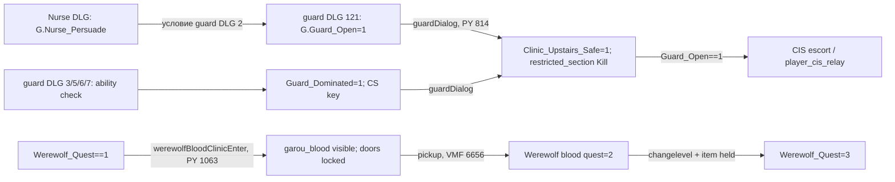

# SM-14.03 — Сценарные зависимости

Стрелки в графе обозначают **условные причинные связи исходников**, не наблюдавшийся гарантированный сценарий. [VMF] `clinic_guard.OnDialogEnd` вызывает `guardDialog()` (ID 5295, L58451), `Nurse.OnDialogEnd` — `nurseDialog()` (ID 5298, L58571), `Lily.OnDialogEnd` — `lilyDialog()` (ID 5293, L58312), `Vandal.OnDialogEnd` — `vandalDialog()` (ID 5294, L58379). [DLG] `clinic_guard.dlg` узлы 1/21/31 увеличивают `G.Guard_Warning`; [PY] при значении ≥3 применяется отложенная враждебность (L858–859), если не выполнена ветка разрешения.

## Начальные условия шести DLG [DLG]

`SM-14_Medical_Assets/SM-14_Dialogue_Rows.csv` содержит все 1401 нумерованных слотов с исходными полями 4–6 и **только явными** числовыми целями. Следующая таблица показывает стартовые слоты, не утверждая, что движок выбирает их в перечисленном порядке. Условия могут пересекаться; наличие реплики в файле не делает её доступной в конкретной игре.

| DLG | Стартовые слоты и условия | Существенные действия |
| --- | --- | --- |
| `clinic_guard` | 193 `Guard_Open==2`; 194 `Guard_Warning>2`; 195 `==2`; 196 `==1`; 197 Nosferatu; 198 первый разговор | 121 `Guard_Open=1`; 141 `Guard_CS=1`, `Guard_Open=1`; 3/5 Dominate/Dementation дают CS key; 6/7 требуют `Patch_Plus==1` для Thaumaturgy/Presence; 152 — seduction/feed и ключ. |
| `nurse` | 122–123 Nosferatu; 124 `Nurse_Flag==1`; 125 `Nurse_Safe==1`; 126/127 предупреждение 2/1; 128 повторный разговор; 129 не первый разговор | 31 `Nurse_Flag=1`, сброс предупреждений; 61 лестничный ключ + `Nurse_Persuade=1`; 71 ставит `Nurse_Warn=1`. |
| `malcolm` | 152/154 Nosferatu; 153 повтор; 155 первый разговор | 82 `Malcolm_Affair=4`; 83 при `Intimidate 3` ставит `Malcolm_Affair=5`. `heatherCheck()` по этим флагам показывает разные деньги только при `Patch_Plus==1` и живом Malcolm [PY L870–881]. |
| `phil` | 101 `Phil_Seduce==1 && Patch_Plus==1`; 102 `Phil_Asleep==1` или seduce; 103 persuasion/drop; 104 начало; 105 первый разговор | 31 `Phil_Persuade=1`; 32/33 условная награда опыта; 62/63 вызывают `philDropNote()` при `Phil_Drop==0`, 64/65 кормление после выпадения записки. |
| `lily` | 284 extort/pissed; 285 `E_Quest==3`; 286 release; 287 refuse; 288 первый разговор | 12/22/32 ставят `Lily_Release=1`; 171 пишет `E_Quest=3`, `Lily` quest stage 3 и Humanity +1. |
| `vandal` | 513–526: поздний `Story_State`, состояние Danielle/Gimble, освобождение Lily, счётчик крови, торговля, первый разговор | 61/501 пишут `Lily_Free=2`; 471 `Vandal_Permission=1`; 77 при `Patch_Plus==1 && Vandal_Plus==0` ставит `Vandal_Fight=1`; 365/366 закрывают Danielle через `Vandal_Quest=4`, `Gimble_Vandal=2`. |

Примеры взаимоисключения: `vandal` слоты 518/519 делят `Lily_Free==1` по `IsDead("Phil")`; слоты 82/84 и 92/93 разделены `Patch_Plus==0/1`. `clinic_guard` варианты 6/7 требуют Plus, 3/5 такой проверки не содержат. Это сравнение текстовых условий DLG; приоритет выбора между **пересекающимися** стартовыми условиями требует подтверждения логикой движка или игровым наблюдением.

| Последовательность | Условие и действие | Доказательство |
| --- | --- | --- |
| Heather | `heatherCheck()` скрывает/удаляет NPC при `G.Heather_Drank==1` или `G.Story_State>=10`; `heatherDialog()` при `G.Nurse_Warn==3` вызывает охрану и `nurse_trigger_killer`. | [PY] L862–910; [VMF] NPC 5292, relay 6634 |
| Lily / Phil | `philCheck()` при `G.E_Quest==2` показывает Phil и меняет keypad; при 3 скрывает Lily. `lilyDialog()` при `G.Lily_Release && !G.Lily_Free` запускает `lily_relay`; если свободна, `lily_leave`. | [PY] L918–940, 978–989; [VMF] Phil 6144, Lily 5293, relay 6508 |
| Vandal | `vandalDialog()` при `G.Vandal_Permission` отпирает `employee_entrance`; при `G.Lily_Free==2` переключает сцену или, для `G.Patch_Plus==1 && G.Vandal_Fight==1`, делает Vandal враждебным. | [PY] L1035–1055; [VMF] Vandal 5294, relay 6610 |
| Werewolf blood | Вход с `G.Werewolf_Quest==1` показывает кровь и закрывает `left_door`/`hack_door`; подбор пишет стадию 2; выход с предметом пишет глобальную стадию 3. | [PY] L1063–1084; [VMF] item 6656, exits 5299/5309 |
| Thin Blood / freezer code | Терминал Blood Bank показывает код только при условиях `G.E_Quest` и вызывает `freezerCode()`; функция при отсутствии `Phil_Persuade`, `Phil_Drop`, `Phil_Code` ставит `Phil_Code=1` и награждает `Thinned05`. | [DATA] `blood_bank_computer.txt` L27–40; [PY] `vamputil.py` L1108–1112 |
| Gimble / morgue | `logic_auto` VMF L70542 на загрузке вызывает `gimbleDead()`; при `Knox_Quest==5 && Patch_Plus==0` или `VirgilCrumbKnowledge==1` скрипт кладёт `gimble_ring/key` в `morgue_trunk` и показывает тело. | [VMF] `morgue_trunk` ID 6146 и OnMapLoad L70542; [PY] `santamonica.py` L794–804 |

`G.Patch_Plus` явно проверяется в ветках Heather, Vandal, guard DLG и других местах скрипта. Эти действия нельзя без сравнения переносить на игру 2004 года. CSV сохраняет полный **статический набор** строк шести DLG; он не симулирует движок, не создаёт рёбер по соседству реплик и не доказывает реальную достижимость каждого узла.

## Дополненные сценарные ветки по установленным UP BSP и DLG

Ниже — точечная сверка пропущенных narrative-веток; ID являются строками DLG, а проверки характеристик/кланов остаются условиями, которые оценивает движок.

### Danielle / Vandal: замена донора

`Danielle` — журнал “Replanting A Lily”. Vandal ID 382 при `Vandal_Quest==0` ставит `Vandal_Quest=1`, журнал 1 и `Vandal_Plus=0`.

| Вариант | Узлы / условия | Действие и outcome |
| --- | --- | --- |
| Danielle из Asylum | `danielle.dlg:12/23/42/62/82/93/112` дают отсылку при `Vandal_Quest==1`; ID71 принимает направление к банку | `Vandal_Quest=3`, `Danielle=2`; отчёт Вандалу завершается узлом `vandal.dlg:411` (`Danielle=6`, XP Danielle01 из quest table). |
| Patty из Downtown | `patty.dlg:96/97` проверяют `Vandal_Quest==1 && Patch_Plus==1`, ставят `Vandal_Quest=3` и `Patty_SM=1`. У 96 порог Humanity 3 и потеря 1 Humanity, у 97 условие `Humanity -3`. | ID 105/106 пишут `Danielle=4`, ID 106 при `Skelter_Quest==3` также пишет `Junky=2`. Журнал Danielle=5 описывает смерть Patty до её прихода. |
| Stan Gimble | `stan_gimble.dlg:162/193` требуют Persuasion 5, Plus и `Vandal_Quest==1`; ведут к ветке 255. ID256 (`Humanity 4`) /257 (`Humanity -4`) назначают Vandal_Quest=3, Gimble_Vandal=1, Danielle=7; ID256 дополнительно отнимает 1 Humanity. | Для сдачи отчёта Vandal start ID515 ведёт к 361; `vandal.dlg:365/366` завершает Danielle=6, Gimble_Vandal=2; ID365 продаёт кровь/открывает бартер, ID366 — без покупки. |
| Компенсация деньгами | `vandal.dlg:399`, только Plus и игрок имеет ≥$200 | Списывает $200, помечает Vandal shop/quest outcome и ставит Danielle=6 (AwardXP `Danielle01` указан в журнале). |
| Vandal hostile/coercion | Vandal DLG содержит Intimidate 4/ Dominate 1 / Thaumaturgy 1 / Dementation 1 варианты (например 393/394/396/397) | Это отдельные разговорные ответы о покупке крови/поиске донора; сами по себе не завершают Danielle. Доступность не равна успешному исходу всей цепочки. |

В установленном `sm_medical_1.bsp` присутствие Clinics NPC и триггеров можно проверить независимо от VMF; сама Danielle/Patty — не клинические NPC. Точки перехода и персонажи Asylum/Downtown относятся к другим картам, поэтому их исходы здесь перечислены только как связи соответствующих DLG.

### Heather: rescue / failure и различие Basic/Plus

| Узел / callback | Gate / scripted result | Практическое следствие из источника |
| --- | --- | --- |
| `main characters/heather.dlg:11` | Реплика запрашивает врача; action `Heather_Know=1; heatherQuest1()` | `heatherQuest1()` пишет Heather state 1 только при `Patch_Plus==1`; в Basic есть разговор, но этот журнал не открывается этой функцией. |
| Heather DLG 32 (Plus) /34 (Basic) | Дать свою кровь доступно при `pc.bloodpool>1`; обе ставят `Heather_Steve=1` | Обе ветви запускают лечение/сцену. Это отдельный Plus-only журнал, а не Plus-only действие спасения. |
| Heather DLG 41 | После питья: `Heather_Drank=1`, `Heather_Steve=2`, Humanity +1, player Bloodloss(1), `heatherQuest2()` | Heather state 2 и XP Heather01 добавляются только Plus, поскольку helper проверяет `Patch_Plus==1`; игра сохраняет последствия спасения в обоих вариантах. |
| BSP callback `OnDeath=heatherQuest3()`; также `heatherCheck()` при `Story_State>=10` удаляет Heather | Если Plus, Heather не пила кровь и quest state=1, ставит state 3 (failure) | Истечение времени/смерть закрывает активное Plus-задание провалом; при уже спасённой Heather условие не проходит. |

Наличие NPC, callback и `logic_auto`-запуск `heatherCheck()` проверены в установленном Medical BSP; сцена лечения и фактическое расписание триггеров в игре не запускались.

### Werewolf Blood: Clinic entry / pickup / exit и базовая доступность

Письмо Haven `A favor` требует `G.Mercurio_Quest >= 2` и вызывает `werewolfBloodQuestAssigned()`; в этом helper нет проверки `Patch_Plus`, и quest state 1 ставится лишь когда `Werewolf_Quest==0`. На Clinic BSP `logic_auto.OnMapLoad` вызывает `werewolfBloodClinicEnter()`: если `Werewolf_Quest==1`, функция показывает `garou_blood` и закрывает `left_door` и `hack_door`. Пикап предмета `garou_blood` вызывает `werewolfBloodPickup()` → journal state 2. Обе `trigger_changelevel` точки выхода (`MedicalTeleport1`, `MedicalTeleport2`) имеют `OnChangeLevel=werewolfBloodClinicExit()`; функция ставит глобальный `Werewolf_Quest=3` только если у игрока всё ещё есть `item_g_werewolf_bloodpack`. Это поведение скриптом не ограничено Plus, поэтому статически оно есть в Basic и Plus вариантах UP; игровой доступность/результат не проверялись.

Вызов при подборе использует литерал `"Werewolf blood"`, определение журнала — `"Werewolf Blood"`. Обработка регистра относится к движку. При выходе из Haven с образцом в ящике `mailboxExitCheck()` убирает образец, кладёт `werewolf_reward`, ставит глобальный `Werewolf_Quest=4` и журнал 3, вызывает `ChangeMasqueradeLevel(-1)`. Ответное письмо в `haven_pc.txt` через `werewolfBloodQuestDone()` пишет успешное состояние 4. Ключ `Wblood02` подтверждён в `quests_santamonica.txt`. [[../pawnshop1/SM-29_Pawnshop_1_Passport]]

## Установленные источники для дополнения

SHA-256 ниже относится к loose-файлам/карте из `Unofficial_Patch` установленной игры; Medical BSP entity lump v17 был прочитан напрямую для проверки `MedicalTeleport1/2`, `logic_auto`, `garou_blood` и callback-полей.

| Файл | SHA-256 |
| --- | --- |
| `maps/sm_medical_1.bsp` | `1c7b0284e75a294050a3263a7e978a692e3590c448e185420258624bee9849a7` |
| `dlg/santa monica/vandal.dlg` | `d7c88c24d1e73c17c74016c39ec42b179745c8b3394362a30e8e5c1bdd401e3e` |
| `dlg/santa monica/stan_gimble.dlg` | `54794300b3ef97cb352a4151e3a01493919b89ac12bfde87a639c5e9234d298d` |
| `dlg/santa monica/danielle.dlg` | `8a000e6b5e2e7c286a73befee0d465e31619ac9763d2e54ef5805ea954d40a28` |
| `dlg/downtown la/patty.dlg` | `4e8eefe8cba0365e17ab80da424559653e86797058b1f6b8aac196afbfba4994` |
| `dlg/downtown la/skelter.dlg` | `c093a0be50de113e0b138b17657b3837e4473a688fa603d0d410d482049d0cbd` |
| `dlg/main characters/heather.dlg` | `be6b2e015a0328112347dc50c2bceae9a3e9752b12552b86bacb8f465b09fd11` |
| `dlg/santa monica/malcolm.dlg` | `213dbdeef51a194a4a56b3829e0925df2c578f3823e3c3436c7e8732be3f7151` |
| `dlg/santa monica/clinic_guard.dlg` | `d2373d1f9a5acb4bd3c29ccb5a5ae68bd12c611b85d0b67aed9010466209aaa7` |
| `python/santamonica/santamonica.py` | `634c5a2e97566d709157f4cd43424509689199302a6433708f3d2ced53f13fff` |
| `python/vamputil.py` | `a2873d3a2a230c0ac9f38398e093910810f7ab3c51fa06bae71a7b004168e491` |
| `vdata/hackterminals/haven_pc.txt` | `7b8db3d8dad85c340cc86e6f5c7c24e63f9e3f784a39017a177547e6102c796d` |
| `vdata/system/quests_santamonica.txt` | `d1f4cc18f44d4f231d0764a1d49da314fe4fb383ca70cddae8ef23db28b02f38` |
