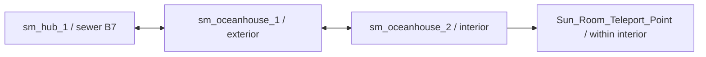

# SM-20.01 — Пространство и переходы

## Проверенный каркас

`sm_oceanhouse_1` содержит подход к зданию, переднюю дверь, стойку с ключом, трейлер и люк B7. `sm_oceanhouse_2` содержит внутренние области с lobby, лестницей, лифтом, boiler area, дневником и sun room. Это идентификация зон по именованным entities VMF, **не** доказанная схема проходимости. Для моделирования этажей и маршрута нужны отдельная геометрическая разметка и проверка коллизий.

| Откуда → куда | VMF entity / действие | Установленный BSP | Доступность и тип |
| --- | --- | --- | --- |
| `sm_hub_1` sewer B7 → `sm_oceanhouse_1` | `ManholeB7.OnActivate → oceantrans.ChangeNow`; `oceantrans.map=sm_oceanhouse_1` в hub, см. [[../../Space/Sewers]] | Сверено ранее в Sewers | Загрузочный переход; Plus оставляет B7 видимым после `Therese_Quest>1`, Basic скрывает; иные ограничения UNVERIFIED |
| `sm_oceanhouse_1` → `sm_oceanhouse_2` | `Leave_Teleport`, `trigger_changelevel`, `map=sm_oceanhouse_2`, `landmark=OH_Landmark` (VMF1:52335–52342) | `Leave_Teleport` с теми же map/landmark в entity lump | Загрузочный переход, фактическое срабатывание UNVERIFIED |
| `sm_oceanhouse_2` → `sm_oceanhouse_1` | `Leave_Teleport`, `trigger_changelevel`, `map=sm_oceanhouse_1`, `landmark=OH_Landmark` (VMF2:162458–162464) | Совпадает по именам/map/landmark | Загрузочный переход; блокировка выхода до завершения требует runtime проверки |
| `sm_oceanhouse_1` → `sm_hub_1` sewer | `ManholeB7.OnActivate → oceantrans.ChangeNow`; `oceantrans.map=sm_hub_1`, `landmark=oceanhouse` (VMF1:52701–52804) | Эти entities присутствуют | Загрузочный переход, runtime UNVERIFIED |

`sm_oceanhouse_1` и `sm_oceanhouse_2` не следует трактовать как непрерывную геометрию. `Return_Teleport_Trigger` внутри `sm_oceanhouse_2` — `trigger_teleport` к `Sun_Room_Teleport_Point`, то есть внутрикартовый телепорт, а не загрузка другой BSP (VMF2:151436, 153726–153735; BSP entity lump).

## Объекты, влияющие на путь

- VMF1: `Key_Button.OnPressed` выдаёт `item_k_oh_front_key`, скрывает полную стойку и показывает пустую (L52458–52466). `front_door_1_knob.OnSkillSuccess` удаляет кнопку ключа и подсказку (L52418–52435). Это статические альтернативные связи для доступа, без вывода о достижимости навыка.
- VMF2: `pendant.OnPlayerPickup` показывает `Return_Teleport_Trigger` через 0.5 s; тот вызывает `Level_Finished` при `OnStartTouch` (L151552–151558, 153726–153735). `Level_Finished` удаляет `Leave_OH_Block` и разблокирует `front_door_1_knob` (L158729–158750). Физическая блокировка и порядок обработки в игре UNVERIFIED.
- VMF2 содержит `elevator` (`func_elevator`, L158996–159009), `elev_fall_event_trigger` (L161549–161557), `Boiler_Events_Trigger` и опасные `Boiler_Steam*_Trigger` (`trigger_hurt`, L157172–157639, 158115–158199). Их существование не устанавливает обязательный маршрут игрока.

## Рабочая схема переходов

Стрелки показывают статически заданные связи, не подтверждённое игровое прохождение. Подробный районный реестр ещё не составлен.
