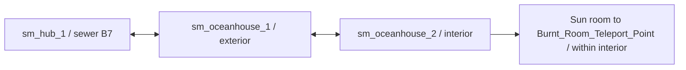

# SM-20.01 — Пространство и переходы

## Проверенный каркас

`sm_oceanhouse_1` содержит подход к зданию, переднюю дверь, стойку с ключом, трейлер и люк B7. `sm_oceanhouse_2` содержит внутренние области с lobby, лестницей, лифтом, boiler area, дневником и sun room. Это идентификация зон по именованным entities VMF, **не** доказанная схема проходимости. Для моделирования этажей и маршрута нужны отдельная геометрическая разметка и проверка коллизий.

| Откуда → куда | VMF entity / действие | Установленный BSP | Доступность и тип |
| --- | --- | --- | --- |
| `sm_hub_1` sewer B7 → `sm_oceanhouse_1` | `ManholeB7.OnActivate → oceantrans.ChangeNow`; `oceantrans.map=sm_oceanhouse_1` в hub, см. [[../../Space/Sewers]] | Сверено ранее в Sewers | Загрузочный переход; `oceanHouseQuest()` не скрывает B7 в Plus при `Therese_Quest>1`, а в Basic вызывает скрытие; иные ограничения UNVERIFIED |
| `sm_oceanhouse_1` → `sm_oceanhouse_2` | `Leave_Teleport`, `trigger_changelevel`, `map=sm_oceanhouse_2`, `landmark=OH_Landmark` (VMF1:52335–52342) | `Leave_Teleport` с теми же map/landmark в entity lump | Загрузочный переход, фактическое срабатывание UNVERIFIED |
| `sm_oceanhouse_2` → `sm_oceanhouse_1` | `Leave_Teleport`, `trigger_changelevel`, `map=sm_oceanhouse_1`, `landmark=OH_Landmark` (VMF2:162458–162464) | Совпадает по именам/map/landmark | Загрузочный переход; блокировка выхода до завершения требует runtime проверки |
| `sm_oceanhouse_1` → `sm_hub_1` sewer | `ManholeB7.OnActivate → oceantrans.ChangeNow`; `oceantrans.map=sm_hub_1`, `landmark=oceanhouse` (VMF1:52701–52804) | Эти entities присутствуют | Загрузочный переход, runtime UNVERIFIED |

`sm_oceanhouse_1` и `sm_oceanhouse_2` не следует трактовать как непрерывную геометрию. `Return_Teleport_Trigger` внутри `sm_oceanhouse_2` — `trigger_teleport` с `landmark=Sun_Room_Teleport_Point`, но `target=Burnt_Room_Teleport_Point`: направление из sun room к burnt room. Это внутрикартовый телепорт, а не загрузка другой BSP (VMF2:153718–153735; BSP entity lump).

## Объекты, влияющие на путь

- VMF1: `Key_Button.OnPressed` выдаёт `item_k_oh_front_key`, скрывает полную стойку и показывает пустую (L52458–52466). `front_door_1_knob.OnSkillSuccess` удаляет кнопку ключа и подсказку (L52418–52435). Это статические альтернативные связи для доступа, без вывода о достижимости навыка.
- VMF2: `pendant.OnPlayerPickup` показывает `Return_Teleport_Trigger` через 0.5 s; тот вызывает `Level_Finished` при `OnStartTouch` (L151552–151558, 153726–153735). `Level_Finished` удаляет `Leave_OH_Block` и разблокирует `front_door_1_knob` (L158729–158750). Физическая блокировка и порядок обработки в игре UNVERIFIED.
- VMF2 содержит `elevator` (`func_elevator`, L158996–159009), `elev_fall_event_trigger` (L161549–161557), `Boiler_Events_Trigger` и опасные `Boiler_Steam*_Trigger` (`trigger_hurt`, L157172–157639, 158115–158199). Их существование не устанавливает обязательный маршрут игрока.

## Высоты и привязка к установленным BSP

- Exterior: `info_player_start=(1152,-1227,48)`, `oceantrans=(1200,-1341,57.5)`. Под стартом найдены горизонтальные бетонные грани 3261 и 3264 на Z=-12, относящиеся к нижнему подходу. Переход в здание `Leave_Teleport=(-190.5,-71.5,181)`, с landmark `OH_Landmark=(-192,-104,133)`. Interior использует landmark `(-198,8,133)` и дверь с таким же именем перехода.
- Interior: у основного `info_player_start=(-194.01,8,172)` горизонтальное дерево на Z=128 (11766, 11753). Под вторым стартом `(-758,606,-160)` бетонные грани на Z=-165 и -193 (9578, 12022). В одной вертикальной колонке X≈-820, Y=498…539 BSP содержит двери `elev2` с origin Z=306.5, `elev3a/b` на 442.5 и `basementeleva/b` на -129. Эти Z относятся к дверям; `func_elevator` отдельно задаёт движение по этажам. Вентиляционная `ventdoorb.OnBreak` скрывает лифт и подготавливает сцену падения.
- Короткая связь комнат подтверждена в обе стороны: `Teleport1` у `(-1029,880,578)` задаёт `landmark=Burnt_Room_Teleport_Point` и `target=Sun_Room_Teleport_Point`; обратный `Return_Teleport_Trigger` у `(-1436.18,888.31,948)` задаёт их наоборот. Точки `Burnt`/ `Sun` совпадают по XY `(-970,894)` и имеют Z=536/928. Под обратным объёмом установлена грань с ковром на Z=920 (12243).

Грани перечислены по индексам lump 7 установленных карт (SHA в [[SM-20_Ocean_House_00_Index|паспорте]]). Они задают локальные высоты, а полный маршрут лестниц, падения и доступность лифта до/после breaker остаются открытыми.

## Рабочая схема переходов

В выборке брашей подтверждены короткий внешний подход к двери (`ocean-exterior-front`), сектор от нижнего старта до площадки рядом с лифтом (`ocean-lift-lower`) и путь по Z=920 от `Sun_Room_Teleport_Point` к точке рядом с pendant (`ocean-upper-pendant`). Длинный подход от exterior start достиг лимита сетки. Exterior содержит 328 displacement-записей, которые этим методом не обработаны. [[../../Space/Santa_Monica_BSP_Brush_Routes.csv]]

Барицентрическая проба скомпилированных displacement-треугольников exterior показывает Z=29.75 под стартовым XY `(1152,-1227)`, где brush-only опора на Z=-12. Совпали face 4101/disp 326/triangle 8 и face 3891/disp 116/triangle 15. При `(1000,-1115)` та же disp 116 даёт Z=56.96 (triangle 19), при `(850,-950)` face 3888/disp 113/triangle 14 — Z=111.18. Так измерены части подъёма. Связь этих частей, дверного порога и поверхности у B7 требует сквозной пробы, учитывающей рельеф.

В BSP interior world brush 1178 имеет лестничный флаг и границы X −730…−729, Y 593…617, Z −193…439. У `elevator` (`*280`) три заданных Z 320, −128 и 457, у `dumbwaiter` (`*109`) два значения 195 и −144. Это уровни позиционирования подвижных моделей. Дверные pivot и Z пола в точках подхода измерены отдельно. Доступность лестницы и кабины зависит от сцены с вентиляцией.

Стрелки показывают статически заданные связи. Их места в районе перечислены в [[../../Space/Transitions|общем реестре]].
