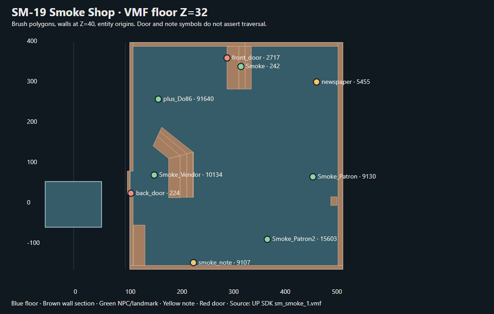

# SM-19 — Smoke Shop

**PARTIAL; RUNTIME PENDING.** После SM-18 начат следующий интерьер. Это проверенный первый блок, не итоговое исследование. Полная проверка I/O и сопоставление с установленным BSP ещё не готовы.

[SVG](SM-19_Smoke_Assets/SM-19_Smoke_Map.svg) · [PNG](SM-19_Smoke_Assets/SM-19_Smoke_Map.png). [VMF] Основной пол — реальная верхняя грань solid 28/side 162, Z=32, X=109…521, Y=−160…401; стены построены сечением брашей на Z=40. Отдельный полигон слева на схеме — иной solid 13220/side 2832, не доказанный проход из основного помещения. Точки дверей, NPC и записки являются `origin`, а не маршрутом.

## Источники

- [VMF] `Reference/Vampire - The Masquerade Bloodlines/SDKContent/MapSrc/up sources/sm_smoke_1.vmf`: 11464 строк, 133 сущности, 24 класса; `worldspawn.levelscript=santamonica`, `safearea=1`, `copwaitarea=1`. Структурная выгрузка `SM-19_Smoke_Assets/vmf-extract.json`: 55 верхних полигонов граней и 29 сечений на Z=40.
- [DLG] `Unofficial_Patch/dlg/santa monica/smoke.dlg`: 55 строк; переходы и условия сохранены в `SM-19_Smoke_Assets/SM-19_Dialogue_Rows.csv`. `plus_Doll6` ссылается на отдельный `dlg/Generic/Doll6.dlg`; его ключевая ветка проверена ниже.
- [PY] `Unofficial_Patch/python/vamputil.py:697–704,1302–1318`; [DATA] `Unofficial_Patch/vdata/signs/smoke_note.txt`.
- [DATA] Loose `sm_smoke_1.bsp` найден: `Unofficial_Patch/maps/sm_smoke_1.bsp` (601549 B, 2026-11-10); base `Vampire/maps` не содержит (карта UP+). Статическая сверка entity lump с VMF — следующий шаг; до неё соответствие SDK VMF установленной карте формально открыто.

## Подтверждённая Library цепь

1. [PY] `vamputil.py:1302–1309`: `librarySetQuest()` при `G.Library_Smoke=0` задаёт квест `Library=1` и `G.Library_Smoke=1`. Источник вызова, приводящего сюда игрока, требует межкартовой проверки.
2. [PY] `vamputil.py:697–704`: при `G.Library_Smoke=1` сущности `smoke_note` и `smoke_note_node` показываются; при других состояниях скрываются. Это зависит от фактического вызова соответствующей функции.
3. [VMF] `smoke_note` ID 9107 `(232,-144,92)` изначально скрыта; `OnReadBegin` убивает `smoke_note_node` ID 12572, ставит `G.Library_Smoke=2`, через 0.1 c вызывает `librarySetQuest()` (L4545–47). [PY] При состоянии 2 функция задаёт `Library=2`, `G.Library_Note=1`, `G.Library_Smoke=3` (L1310–1314). Текст [DATA] указывает на новую записку у пирса; содержание не доказывает посещение пирса.
4. [DLG] `Smoke_Vendor` ID 10134 использует `smoke.dlg`. Начальные условия IDs 53–55: повторный разговор при `G.Smoke_Talked=1` → 11; первый Nosferatu → 41; прочий первый → 1. При `G.Library_Smoke=1` IDs 2/3/42 позволяют спросить о Scott и ставят `G.Smoke_Talked=1`. IDs 13/43 требуют `G.Library_Smoke=2`; это краткое состояние между чтением записки и `librarySetQuest()` в VMF, доступность этих ответов в игре не доказана.
5. [VMF] `front_door` ID 2717 `(297,363.04,108.5)` OnOpen → `smoke_transition.ChangeNow` (L3293). `smoke_transition` ID 240 ведёт в `sm_hub_1`, landmark `Smoke` ID 242 `(324,342,70)`. В SDK `sm_hub_1_d.vmf:179363–179368` `plus_smoke_door` ведёт на `smoke_transition`, который направлен в `sm_smoke_1` (L179494–503). Это исходная двусторонняя связь, не runtime-проверка.

## Остальные сущности и точка продолжения

- [VMF] `Smoke_Patron` ID 9130, `Smoke_Patron2` ID 15603 и `plus_Doll6` ID 91640 находятся в этой VMF. У Doll6 OnDeath ставит `G.Doll6_Dead=1` (L11398); [PY] `vamputil.py:627–632` удаляет Doll6 при сохранённом состоянии смерти и `Smoke_Vendor` при `G.Vendor_Dead=1`.
- [DLG] `Generic/Doll6.dlg` IDs 2/3 при Seduction 3 ведут к ID 11 и ставят `G.Doll6_Seduce=1`; ID 12 ставит `G.Seductive_Feed=1` и вызывает `pc.SeductiveFeed(npc)`. Альтернатива ID 4 при `Seduction -3` ведёт к ID 21→22 (Auto-End). Начальные условия IDs 44–46 различают Nosferatu, повторный разговор после соблазнения и первый разговор; соседство строк не использовано как связь.
- [VMF] Газета `prop_sign` ID 5455 `(470.44,303.514,63.2341)` по `OnReadBegin` вызывает `murderPaperRead()` (L4156). [PY] `santamonica.py:1383–1387` ставит `Serial=1` только если текущий этап `Serial=0` и `G.Story_State<5`. Это условная отдельная квестовая ветка, не обязательный эффект чтения.
- Следующий блок: проверить связность задней двери с отдельным полигоном, условия доступа со стороны hub и соответствие найденного UP+ BSP (601549 B); затем дать SOURCE COMPLETE либо честный PARTIAL.
