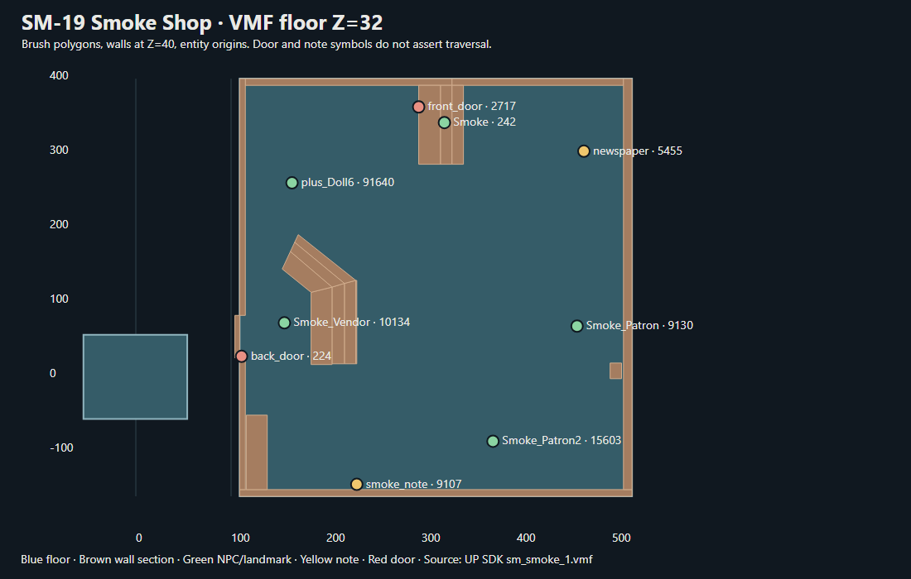

# SM-19 — Smoke Shop

**Сверка UP BSP.** В установленной карте 95 entities. Сопоставлены переход, записка и её три выхода, продавец, два посетителя, Plus-копия Doll6 и газета. Геометрия VMF-схемы и выборочные грани установленной карты указаны с разным происхождением.

[SVG](SM-19_Smoke_Assets/SM-19_Smoke_Map.svg) · [PNG](SM-19_Smoke_Assets/SM-19_Smoke_Map.png). [VMF] Основной пол — реальная верхняя грань solid 28/side 162, Z=32, X=109…521, Y=−160…401; стены построены сечением брашей на Z=40. Отдельный полигон слева на схеме — иной solid 13220/side 2832, не доказанный проход из основного помещения. Точки дверей, NPC и записки являются `origin`, а не маршрутом.

## Источники

- [VMF] `Reference/Vampire - The Masquerade Bloodlines/SDKContent/MapSrc/up sources/sm_smoke_1.vmf`: 11464 строк, 133 сущности, 24 класса; `worldspawn.levelscript=santamonica`, `safearea=1`, `copwaitarea=1`. Структурная выгрузка `SM-19_Smoke_Assets/vmf-extract.json`: 55 верхних полигонов граней и 29 сечений на Z=40.
- [DLG] `Unofficial_Patch/dlg/santa monica/smoke.dlg`: 55 строк; переходы и условия сохранены в `SM-19_Smoke_Assets/SM-19_Dialogue_Rows.csv`. `plus_Doll6` ссылается на отдельный `dlg/Generic/Doll6.dlg`; его ключевая ветка проверена ниже.
- [PY] `Unofficial_Patch/python/vamputil.py:697–704,1302–1318`; [DATA] `Unofficial_Patch/vdata/signs/smoke_note.txt`.
- [BSP] `Unofficial_Patch/maps/sm_smoke_1.bsp` SHA-256 `6c72a049220643980f274f050649a625a0c88269bd909a0a8d79a691c6783dfa`; VMF SHA-256 `79f91efb80c1cbd80b600b067ebdd1242fd03faa527a76eda1e7058fa66aac04`; `smoke.dlg` SHA-256 `fb089128e245c9475acf0574a7104e9fabb182c7d1885ec229d57dcf28fe7a6f`; `vdata/signs/smoke_note.txt` SHA-256 `b87326db6ab4bdc122388ce1af29cf3c5efd1f282c81715da170f7ffb475abee`. Базовый каталог `Vampire/maps` не содержит loose BSP этой карты.

## Подтверждённая Library цепь

1. [PY] `vamputil.py:1302–1309`: `librarySetQuest()` при `G.Library_Smoke=0` задаёт квест `Library=1` и `G.Library_Smoke=1`. Вход в цепь — письмо Library в [[../pawnshop1/SM-29_Pawnshop_1_Passport|убежище]]. Условия письма и следующие этапы в [[../../Quests/Index#Night at the Library|цепи квеста]].
2. [PY] Блок Library внутри `setPlus()` (`vamputil.py:702–710`) показывает `smoke_note` и `smoke_note_node` при `G.Library_Smoke=1` и скрывает иначе. Installed BSP `smoke_note.OnReadBegin` совпадает с тремя описанными ниже VMF-выходами. У всех трёх счётчик 1.
3. [VMF] `smoke_note` ID 9107 `(232,-144,92)` изначально скрыта; `OnReadBegin` убивает `smoke_note_node` ID 12572, ставит `G.Library_Smoke=2`, через 0.1 c вызывает `librarySetQuest()` (L4545–47). [PY] При состоянии 2 функция задаёт `Library=2`, `G.Library_Note=1`, `G.Library_Smoke=3` (L1310–1314). Текст [DATA] указывает на новую записку у пирса; содержание не доказывает посещение пирса.
4. [DLG] `Smoke_Vendor` ID 10134 использует `smoke.dlg`. Начальные условия IDs 53–55: повторный разговор при `G.Smoke_Talked=1` → 11; первый Nosferatu → 41; прочий первый → 1. При `G.Library_Smoke=1` IDs 2/3/42 позволяют спросить о Scott и ставят `G.Smoke_Talked=1`. У квестовых выходов записки отсутствует проверка `Smoke_Talked`, поэтому на уровне сохранённого I/O разговор не требуется. IDs 13/43 требуют `G.Library_Smoke=2`; это краткое состояние между чтением записки и `librarySetQuest()`, доступность этих ответов в игре не доказана.
5. [VMF] `front_door` ID 2717 `(297,363.04,108.5)` OnOpen → `smoke_transition.ChangeNow` (L3293). `smoke_transition` ID 240 ведёт в `sm_hub_1`, landmark `Smoke` ID 242 `(324,342,70)`. В SDK `sm_hub_1_d.vmf:179363–179368` `plus_smoke_door` ведёт на `smoke_transition`, который направлен в `sm_smoke_1` (L179494–503). Это исходная двусторонняя связь, не runtime-проверка.

## Остальные сущности и точка продолжения

- [VMF+BSP] `Smoke_Patron` ID 9130, `Smoke_Patron2` ID 15603 и `plus_Doll6` ID 91640 также присутствуют в установленной карте. У Doll6 `OnDeath` ставит `G.Doll6_Dead=1` (VMF L11398, BSP NPC у `164 261 34`). [PY] `vamputil.py:695–700` удаляет Doll6 при сохранённом состоянии смерти и `Smoke_Vendor` при `G.Vendor_Dead=1`. В BSP у продавца нет `OnDeath`. В loose Python, DLG и текстовых данных установленного UP найдено чтение `Vendor_Dead` в `setPlus()`; источник записи этого флага остаётся неизвестным.
- [DLG] `Generic/Doll6.dlg` IDs 2/3 при Seduction 3 ведут к ID 11 и ставят `G.Doll6_Seduce=1`; ID 12 ставит `G.Seductive_Feed=1` и вызывает `pc.SeductiveFeed(npc)`. Альтернатива ID 4 при `Seduction -3` ведёт к ID 21→22 (Auto-End). Начальные условия IDs 44–46 различают Nosferatu, повторный разговор после соблазнения и первый разговор; соседство строк не использовано как связь.
- [VMF] Газета `prop_sign` ID 5455 `(470.44,303.514,63.2341)` по `OnReadBegin` вызывает `murderPaperRead()` (L4156). [PY] `santamonica.py:1383–1387` ставит `Serial=1` только если текущий этап `Serial=0` и `G.Story_State<5`. Это условная отдельная квестовая ветка, не обязательный эффект чтения.
- В UP BSP `sm_hub_1` `plus_smoke_door.OnOpen → smoke_transition.ChangeNow`; `setPlus()` показывает эту дверь и скрывает `basic_smoke_door` в том же pivot. Basic-дверь не содержит соответствующего выхода. Переход из магазина по `front_door.OnOpen` подтверждён.
- В UP BSP у задней двери (грань 271) и под зоной передней двери (269) есть поверхности Z=32. У передней двери дополнительно видны локальные грани Z=57 и 63 (315 и 5). Пробы по world brushes от входа нашли 42 положения до зоны продавца и 49 до записки. [[../../Space/Santa_Monica_BSP_Brush_Routes.csv]]
- `back_door *1` при `(111,28,85)` имеет Starts Locked (2048) и не вызывает загрузку. За её створкой весь проём закрывает world brush 2: X 104…109, Y 26…83, Z 32…141. В SDK VMF с ним совпадает solid 13231 с `TOOLS/TOOLSNODRAW` (стороны 2863 и далее). Sweep от `(145,54,32.05)` к боковой площадке по Y=54 упирается в этот браш при X=125. В пробе `--start 145 54 64 --finish 66 54 88 --grid 8 --step 18 --margin 200 --limit 12000` опоры найдены на Z=32.05 и 64.05, а поиск исчерпал 1025 положений без маршрута с дверной моделью и без неё.
