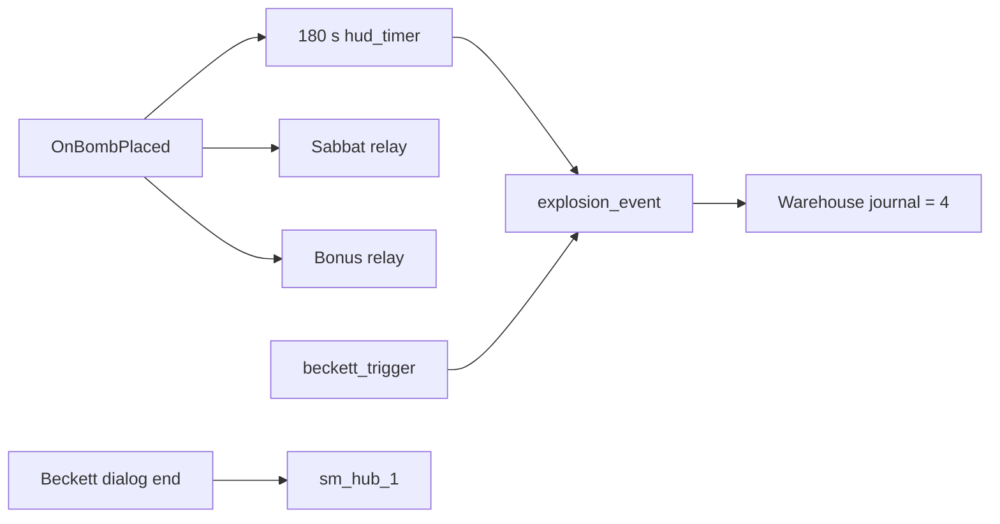

# SM-21.01 — Системы Warehouse

## Доступ и связь с городом

- `bertram.dlg` ID 154/156 и 462–464 требуют `pc.HasItem("item_g_astrolite")` и, на ветках с прямым завершением разговора, записывают `G.Bertram_Ready=2`. Nosferatu ID 155 переходит к 511 без этой записи на самой строке. Эти условия DLG статичны; достижимость реплик UNVERIFIED.
- `sm_hub_1_d.vmf:144329` привязывает `toWarehouse()` к `OnDialogEnd`; `santamonica.py:2125–2128` вызывает `ChangeMap(2.5, "warehouselandmark", "warehouseteleport")` только при `G.Bertram_Ready==2` и `G.Story_State<5`. `sm_hub_1_d.vmf:146522–146523` задаёт `warehouseteleport.map=sm_warehouse_1`. Условие входа подтверждено статически по DLG/VMF/Python, выполнение в игре не проверялось.
- В Warehouse `santamonicateleport` (`trigger_changelevel`) указывает `map=sm_hub_1`, `landmark=warehouselandmark` (VMF/BSP). `Beckett.OnDialogEnd` вызывает `toSantaMonica()`; `warehouse.py:36–37` делает `ChangeMap(2.5, "warehouselandmark", "santamonicateleport")` (VMF/BSP). Это загрузочный переход, не физически непрерывный путь.
- Mercurio DLG ID 121 пишет `Astrolite=1` и `G.Mercurio_Quest=1`, ID 171 — `Astrolite=3`, `Mercurio_Quest=2`, `Mercurio_Astro=2`, ID 231 — `Warehouse=2` по существующему [[../apartment1/SM-16_Apartment_02_Mercurio|анализу SM-16]]. Прямой проверки этих DLG строк в данном пакете нет. В установленном Warehouse BSP не найден класс `item_g_astrolite`; наличие предмета здесь не подтверждено.
- `bertram.dlg` ID 631 после взрыва пишет `G.Bertram_Goodjob=1` и журнал `Warehouse=7`. Это отдельная запись от `Warehouse=4` в `finishWarehouseQuest()`; числовой порядок сам по себе не описывает обязательную последовательность.

## Граф событий: размещение бомбы и взрыв

| Узел | Явные I/O или Python | Источник и граница |
| --- | --- | --- |
| `trigger_bomb_site.OnBombPlaced` | Скрывает `Exit_Block`/`Block_Exit`, показывает и перезапускает `explosion_timer`, включает `beckett_trigger`, через 2 s вызывает `Relay_Trigger_Sabbat` и `Relay_Trigger_Bonus` | VMF L131904–131918; те же связи в UP BSP entity lump; условие размещения бомбы в движке UNVERIFIED |
| `explosion_timer` | `hud_timer.count_time=180`, `OnTimerComplete → explosion_event.Trigger` | VMF около L119336, UP BSP; реальная длительность/паузы UNVERIFIED |
| `beckett_trigger.OnStartTouch` | `beckettSceneStart()` убирает `npc_VHumanCombatant`, скрывает таймер, запускает `explosion_event` | UP BSP; `warehouse.py:29–33`; доступность триггера UNVERIFIED |
| `explosion_event.OnTrigger` | `finishWarehouseQuest()` пишет журнал `Warehouse=4`; запускает звук, экранные/геометрические эффекты и несколько `trigger_hurt` | UP BSP; `warehouse.py:60–61`; живой исход игрока UNVERIFIED |
| `Beckett.OnDialogEnd` | `toSantaMonica()` начинает загрузочный возврат в `sm_hub_1` | UP BSP; `warehouse.py:36–37`; возможность разговора зависит от предшествующей сцены |

Статически `SewerGateLever` (`prop_switch`).`OnActivate → explosion_event.Trigger` присутствует в базовом и установленном UP BSP. Это отдельный вход в relay, но условия доступа к switch, его назначение и возможность завершить миссию без бомбы **UNVERIFIED**. Нельзя называть его подтверждённым альтернативным способом прохождения.

## Противники, бонус и постановка

- Установленный BSP entity lump содержит 38 entities класса `npc_VHumanCombatant`, а также `NPC_Sabbat1/2` и Beckett. Это инвентарь файла, не число одновременно присутствующих противников.
- Несколько guard `OnFoundPlayer` записывают `G.Warehouse_Spotted=1`; `Relay_Thug_Death.OnTrigger` увеличивает `G.Warehouse_Kills` (UP BSP).
- `Relay_Trigger_Bonus → warehouseBonusPoints()` (UP BSP). В Basic при `Warehouse_Kills==0` функция выдаёт `Explosive04`; в Plus при `Warehouse_Spotted==0` — `Explosive06`, переименовывает две Beckett entity и ставит `G.Beckett_Swap=1` (`warehouse.py:40–58`). Эти предикаты определяют разные бонусы, но не доказывают достижимость чистого прохождения.
- `Relay_Trigger_Sabbat` вызывает `bringOnSabbat()`: показывает `NPC_Sabbat1/2`, убирает наружных thugs и показывает `Exit_Block` (`warehouse.py:154–164`). `beckettSceneStart()` убирает всех текущих `npc_VHumanCombatant` (`warehouse.py:29–33`). Точный порядок видимых сцен и камера не проверены.

Граф отражает I/O и Python, не обязательный путь игрока.
