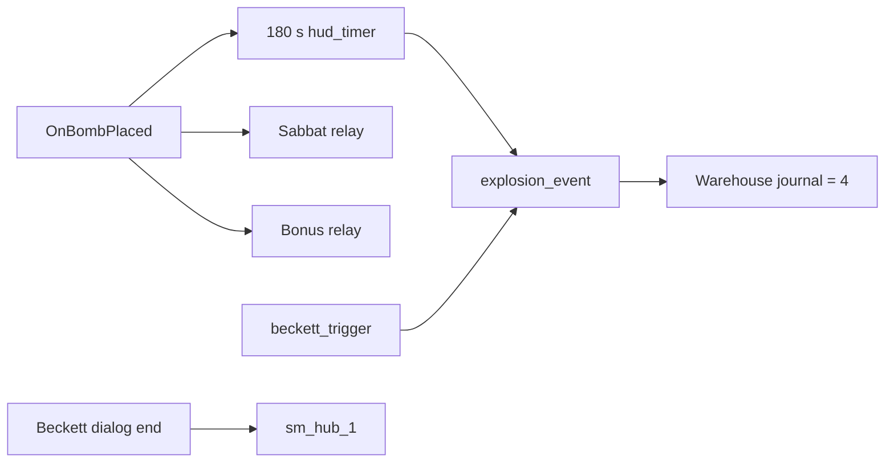

# SM-21.01 — Системы Warehouse

## Доступ и связь с городом

- `bertram.dlg` ID 154/156 и 462–464 требуют `pc.HasItem("item_g_astrolite")` и, на ветках с прямым завершением разговора, записывают `G.Bertram_Ready=2`. Nosferatu ID 155 переходит к 511 без этой записи на самой строке. Эти условия DLG статичны; достижимость реплик UNVERIFIED.
- `sm_hub_1_d.vmf:144329` привязывает `toWarehouse()` к `OnDialogEnd`; `santamonica.py:2125–2128` вызывает `ChangeMap(2.5, "warehouselandmark", "warehouseteleport")` только при `G.Bertram_Ready==2` и `G.Story_State<5`. `sm_hub_1_d.vmf:146522–146523` задаёт `warehouseteleport.map=sm_warehouse_1`. Условие входа подтверждено статически по DLG/VMF/Python, выполнение в игре не проверялось.
- В Warehouse `santamonicateleport` (`trigger_changelevel`) указывает `map=sm_hub_1`, `landmark=warehouselandmark` (VMF/BSP). `Beckett.OnDialogEnd` вызывает `toSantaMonica()`; `warehouse.py:36–37` делает `ChangeMap(2.5, "warehouselandmark", "santamonicateleport")` (VMF/BSP). Это загрузочный переход, не физически непрерывный путь.
- Mercurio DLG ID 121 пишет `Astrolite=1` и `G.Mercurio_Quest=1`, ID 171 — `Astrolite=3`, `Mercurio_Quest=2`, `Mercurio_Astro=2`, ID 231 — `Warehouse=2` по существующему [[../apartment1/SM-16_Apartment_02_Mercurio|анализу SM-16]]. Прямой проверки этих DLG строк в данном пакете нет. В установленном Warehouse BSP не найден класс `item_g_astrolite`; наличие предмета здесь не подтверждено.
- `bertram.dlg` ID 631 после взрыва пишет `G.Bertram_Goodjob=1` и журнал `Warehouse=7`. Это отдельная запись от `Warehouse=4` в `finishWarehouseQuest()`; числовой порядок сам по себе не описывает обязательную последовательность.

## Граф событий: размещение бомбы и взрыв

В установленном BSP есть три лестничных браша. Браш 2866 занимает X −263…−261, Y 388…412, Z −280…134. Браши 3122 и 3105 образуют одну колонку X 828…830, Y 900…924 с нижним Z −254, стыком на −90 и верхом 32. Пробы ходьбы без вертикального подъёма от обоих стартов до объёма бомбы исчерпали сетку. Учёт 1344 displacement-треугольников сохранил этот результат для пробы со второго старта. [[../../Space/Santa_Monica_BSP_Brush_Routes.csv]]

В установленном BSP `info_player_start=(-1986.5,-3053.83,-407)` лежит у `warehouselandmark=(-2005.1,-3016.54,-407)` и `santamonicateleport`; грань 13474 под стартом на Z=−416. С этим landmark связан переход от Bertram из Hub 1. Второй старт `(361.658,843.523,-247)` находится над гранью 10817 на Z=−256. Проба стоячего корпуса от западного старта к восточному с учётом рельефа не нашла маршрута на сетках 6, 8 и 12 с шагом 18. При сетке 12 достижимые точки остались на Z=−415.95, X −2047…−1483, Y −3066…−2970. Дальнейший выход из этого сектора и фактическое размещение после загрузки требуют проверки.

**Локализация западного разрыва.** В world brush 629 есть сплошная грань на X=−1456; браш занимает X −1456…−1428, Y −3100…−2366, Z −480…−320. Он пересекает прямой sweep с западного пола на восток. Верхняя отдельная опора у `(-1560,-2350,-304)` находится на Z=−319.95, на 96 units выше западного пола. Трассы от западного старта до неё при шагах 18 и 96 исчерпали 351 и 951 положений. От зоны станции `(-1769,-1889,-278)` до второго старта модель также исчерпалась (9 860 положений, step 18). Это ограничение выбранных стоячих проб. Связность уровней и применение игровых действий требуют проверки после прибытия от Bertram. [[../../Space/Santa_Monica_BSP_Brush_Routes.csv]]

**Западная трасса до места закладки.** Входной старт связан с бомбой через нижнюю станцию, западную лестницу и вентиляцию. Пробы учитывают world brushes, рельеф и указанные створки в закрытом положении. Другие подвижные модели и нативная механика перемещения требуют отдельной проверки.

1. От западного старта корпус 32×32×36 находит 108 положений до `(-1770.5,-1889.83,-315.35)` рядом с `trigger_soundscheme_trainstation *134`. Маршрут под насыпью идёт через `(-1782.5,-2885.83,-449.55)` и `(-1794.5,-2309.83,-417.36)`. Максимальный подъём между соседними опорами 8,33 units, максимальный спуск 36,97.
2. Из той же точки 13 движений по +Y с шагом сетки 2 дают `(-1770.5,-1863.83,-300.62)`. В арке world brush 1569 оставляет 2,54 units для подъёма корпуса у входа, а наклон world brush 120 требует 6,8 units подъёма на сегмент длиной 12. После арки на конечной опоре помещается корпус 32×32×72.
3. От арки до подножия западной лестницы `(-285,395,-279.95)` найдено 213 стоячих положений. Закрытые `train_bathroom_door_2 *3` и `goofy_door1 *69` блокируют пробу по отдельности. В установленном BSP обе имеют yaw 0 и флаг 256 Use Opens. Для `halfdoorb *74` с закрытой створкой найден обход из 218 положений.
4. У world ladder 2866 на X=−279, Y=400 стоячий корпус встречает верхний world brush 240 на Z=121,38. Низкий корпус допускает вертикальное перемещение до Z=157,38. После бокового sweep от `(-279,400,136.1)` до `(-235,400,136.1)` найдена опора Z=136,05. Верх лестничного браша на Z=134. Доступность такого схода по нативной лестнице проверяется отдельно.
5. От этой опоры до `trigger_bomb_site *98` найдено 166 положений корпуса 32×32×36. Максимальный спуск 169,25 units. `ventdoor *44` закрывает путь при origin `(259.5,457.5,165)`, yaw 0. У `ventportal *45` задано `Solidity=1` (Never Solid). `ventdoor.OnOpen` вызывает `plus_vent_open`, который запускает звук офиса и временно выключает `trig_start_bigconversation`. Условия работы створки, сход с лестницы и посадка после падения остаются для игры.

В установленном BSP нет `trigger_teleport`. Единственный `point_teleport` с игроком как целью, `teleport_player_1`, находится у `(-1144,-1119,-247)` и вызывается в финале Beckett. В `logic_auto.OnMapLoad` отдельного перемещения игрока по карте нет. Фактический вход через landmark от Bertram остаётся в игровом плане. [[../../Space/Santa_Monica_BSP_Brush_Routes.csv]]

**Восточная лестница и подход к бомбе.** С `--terrain --goal-directed --grid 12 --step 18 --margin 370` от второго старта `(362,844,-225)` до `(812,912,-227)` найдено 44 положения на Z=−255.95. На X=812, Y=912 вертикальный sweep стоячего корпуса от Z=−255.95 до −63.90 свободен. Горизонтальный sweep до Y=936 на этой высоте тоже свободен, там есть опора Z=−63.95. Оба sweep повторены с `ladder_fix` (solid=6, origin `838 912 -153`, yaw 90). SDK декодировал одну выпуклую PHY-секцию с checksum MDL/PHY `1767864531` и единичным `static_prop`. Ресурс `models/scenery/structural/ladder/ladder.phy` из `Vampire/pack004.vpk`, SHA-256 `4f543250218c881cb5c3141ca0ddebb16d8fc012a8b1234a546bbd453c8b7592`.

От найденной площадки `(812,936,32.1)` проба опускает корпус на Z=−63.95 и находит 144 положения до `(112,560,-33)` при сетке 8, шаге 18, отступе 650, лимите 25000, `--terrain --goal-directed`. Корпус в конце пересекает браш 3517 модели `trigger_bomb_site *98`. Её границы X 17…208, Y 480…640, Z −63.2…−22.2 совпадают с SDK VMF solid 2804. В `SDKBinaries/vampire.fgd:3586–3591` описаны место закладки и выход `OnBombPlaced`. Подъём, выбор настила и фактическая закладка остаются для проверки в движке. `beckett_trigger *109` расположен отдельно у `(-1028,-1003,-168.71)`.

**Эвакуация к Beckett.** Из зоны бомбы до нижней площадки `(-650.5,-1111.83,-319.95)` найдены 347 стоячих положений. Там стоячий корпус может подняться вертикально на 64 units и сместиться до `(-682.5,-1127.83,-255.95)`, где пересекает `*109`. При подъёме на 62 units выход перекрывает world brush 3087. С показанной моделью `Block_Exit *246` этот же горизонтальный sweep сталкивается с brush 3757 на 54,69% дистанции. Удаление `*246` соответствует выходу `OnBombPlaced`. Показ `Exit_Block *269` в восточной части карты оставляет эту проверку свободной. Диагностический подъём на 64 units задаёт локальный зазор. Игровой способ преодоления зазора и прохождение до истечения таймера остаются открытыми.

| Узел | Явные I/O или Python | Источник и граница |
| --- | --- | --- |
| `trigger_bomb_site.OnBombPlaced` | Скрывает `Exit_Block`/`Block_Exit`, показывает и перезапускает `explosion_timer`, включает `beckett_trigger`, через 2 s вызывает `Relay_Trigger_Sabbat` и `Relay_Trigger_Bonus` | VMF L131904–131918; те же связи в UP BSP entity lump; условие размещения бомбы в движке UNVERIFIED |
| `explosion_timer` | `hud_timer.count_time=180`, `OnTimerComplete → explosion_event.Trigger` | VMF около L119336, UP BSP; реальная длительность/паузы UNVERIFIED |
| `beckett_trigger.OnStartTouch` | `beckettSceneStart()` убирает `npc_VHumanCombatant`, скрывает таймер, запускает `explosion_event` | UP BSP; `warehouse.py:29–33`; доступность триггера UNVERIFIED |
| `explosion_event.OnTrigger` | `finishWarehouseQuest()` пишет журнал `Warehouse=4`; запускает звук, экранные/геометрические эффекты и несколько `trigger_hurt` | UP BSP; `warehouse.py:60–61`; живой исход игрока UNVERIFIED |
| `Beckett.OnDialogEnd` | `toSantaMonica()` начинает загрузочный возврат в `sm_hub_1` | UP BSP; `warehouse.py:36–37`; возможность разговора зависит от предшествующей сцены |

Статически `SewerGateLever` (`prop_switch`).`OnActivate → explosion_event.Trigger` присутствует в базовом и установленном UP BSP. Это отдельный вход в relay, но условия доступа к switch, его назначение и возможность завершить миссию без бомбы **UNVERIFIED**. Нельзя называть его подтверждённым альтернативным способом прохождения.

## Противники, бонус и постановка

- Установленный BSP entity lump содержит 38 entities класса `npc_VHumanCombatant`, а также `NPC_Sabbat1/2` и Beckett. Это инвентарь файла, не число одновременно присутствующих противников.
- Несколько guard `OnFoundPlayer` записывают `G.Warehouse_Spotted=1`; `Relay_Thug_Death.OnTrigger` увеличивает `G.Warehouse_Kills` (UP BSP).
- `Relay_Trigger_Bonus → warehouseBonusPoints()` (UP BSP). В Basic при `Warehouse_Kills==0` функция выдаёт `Explosive04`; в Plus при `Warehouse_Spotted==0` — `Explosive06`, переименовывает две Beckett entity и ставит `G.Beckett_Swap=1` (`warehouse.py:40–58`). Эти предикаты определяют разные бонусы, но не доказывают достижимость чистого прохождения.
- `Relay_Trigger_Sabbat` вызывает `bringOnSabbat()`: показывает `NPC_Sabbat1/2`, убирает наружных thugs и показывает `Exit_Block` (`warehouse.py:154–164`). `beckettSceneStart()` убирает всех текущих `npc_VHumanCombatant` (`warehouse.py:29–33`). Точный порядок видимых сцен и камера не проверены.

Граф отражает I/O и Python, не обязательный путь игрока.
