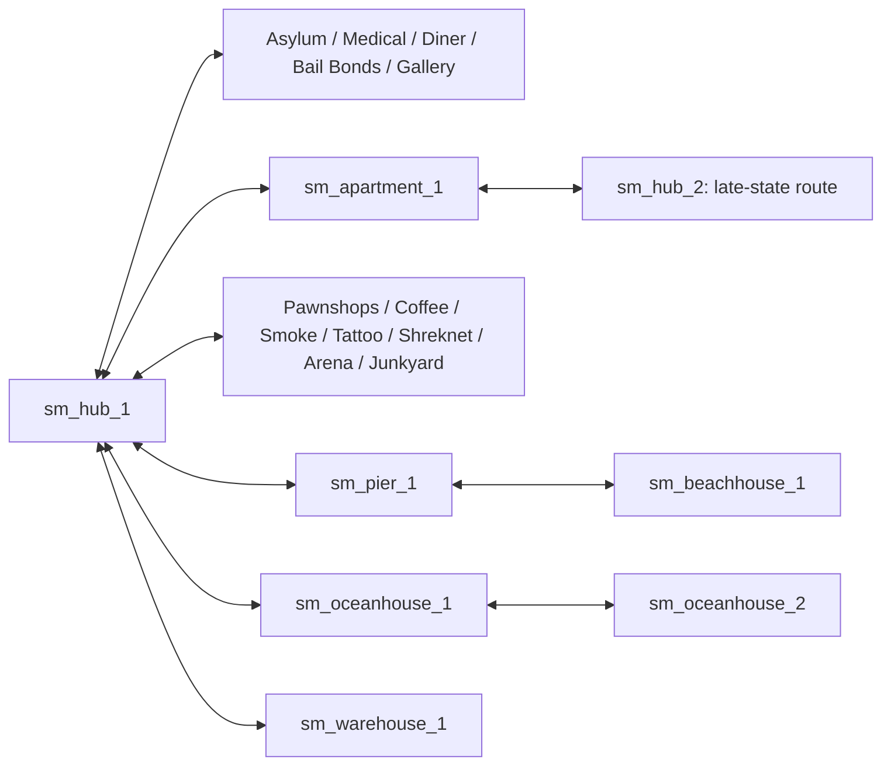

# Santa Monica — реестр загрузочных переходов UP Plus 12.0

В установленном каталоге `Unofficial_Patch/maps/` найдены ровно 22 файла `sm_*.bsp`, совпадающие по именам с матрицей [[../../../KNOWLEDGE_BASE_AUDIT|аудита]]. Из их **установленных BSP entity lump** извлечены 65 entities класса `trigger_changelevel`. Их реестр: [[Santa_Monica_BSP_Changelevels.csv]]. Каждая строка содержит исходную/целевую карту, имя entity, landmark, I/O ссылки на эту entity из той же BSP, SHA-256 BSP и статус `RUNTIME PENDING`. Ссылки включают `ChangeNow`, а также действия вроде `ScriptUnhide`; последние лишь меняют видимость и сами по себе не загружают карту.

Метод: VBSP v17, entity lump с offset/length в заголовке; из каждой entity взяты `classname`, `targetname`, `map`, `landmark` и выходы `On*`, направленные на имя перехода. `referencing_events` сохраняет конкретный input, поэтому `ChangeNow` и `ScriptUnhide` различимы. Совпадение имени и input `ChangeNow` доказывает сохранённую I/O связь, **не** фактическое выполнение. Поле `[not identified in entity I/O]` означает лишь, что прямой выход из entity lump не найден: возможны touch, Python `ChangeMap` и другие механизмы. `availability_condition=UNVERIFIED` не является утверждением, что карта всегда доступна.

## Каркас района по статическим целям

Диаграмма объединяет имена целей; она не описывает условия, этажи, коллизию и достижимость каждого ребра. `sm_hub_2` также содержит назначение `sm_apartment_1b`, отсутствующее среди 22 loose BSP; ранее проверенные VPK индексы не выявили его ([[../../../KNOWLEDGE_BASE_AUDIT|аудит]]). Это `TARGET_NOT_FOUND_IN_CHECKED_SOURCES`, а не доказательство невозможности загрузки.

## Связи, уже разобранные детально

- Ocean House: [[../Locations/oceanhouse/SM-20_Ocean_House_01_Spatial|SM-20 spatial]] и [[Sewers|канализация B7]].
- Warehouse: [[../Locations/warehouse/SM-21_Warehouse_01_Systems|SM-21 systems]]; вход через Bertram зависит от DLG, Python и I/O, поэтому в CSV для `warehouseteleport` прямой entity activator не показан.
- Apartment и поздний Hub: [[../Locations/apartment1/SM-16_Apartment_00_Index|SM-16]].

## Открытая часть реестра

CSV охватывает `trigger_changelevel` только в 22 установленных BSP. Для полноценного графа ещё нужны входы из Python `ChangeMap`, внутрикартовые телепорты, двери/блокировки, условия DLG и runtime-проверка направлений. Поэтому этот реестр имеет статус `PARTIAL / VERIFIED_STATIC / RUNTIME_PENDING` и не делает район готовым к реализации всей RPG.
