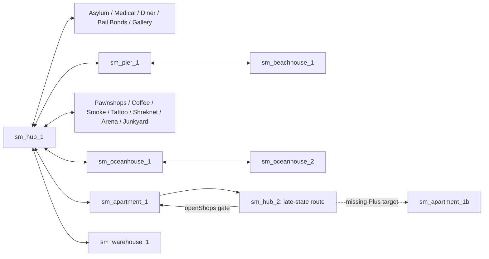

# Santa Monica — реестр загрузочных переходов UP Plus 12.0

В установленном каталоге `Unofficial_Patch/maps/` найдены 22 файла `sm_*.bsp` из [[../Santa_Monica_Research_Index|матрицы карт]]. Из их BSP entity lump извлечены 65 `trigger_changelevel`. Реестр [[Santa_Monica_BSP_Changelevels.csv]] хранит карту, назначение, имя и brush model, пару координат landmarks, слой BSP назначения, I/O, условия, оценку достижимости, SHA-256 и наблюдение в игре. `ChangeNow` активирует переход, а `ScriptUnhide` меняет видимость.

Метод: VBSP v17, entity lump с offset/length в заголовке. Поле `referencing_events` сохраняет конкретный input из выхода `On*`. При отсутствии прямой I/O связи сверены touch flags, Python `ChangeMap` и DLG. Для координат найдено имя `info_landmark` без учёта регистра в установленном UP BSP, затем в базовом loose BSP при отсутствии UP-карты. Пустая координата объясняется в `landmark_discrepancy`. Два исходных `taxi_landmark` в Hub 2 сохранены в одной ячейке через `|`.

## Каркас района по статическим целям

Для всех 65 строк сохранены `spawnflags` и `StartHidden`. В локальном SDK `SDKBinaries/vampire-base.fgd:5610–5637` бит 2 называется `Disable Touch`. Он установлен у 56 переходов. SHA-256 FGD — `edadc8ee9dd3eb049c1d6d3e5acc3b945b16df6b95d16fb4cce895ee542003ba`.

У 56 записей найден механизм активации (дверь, Python/DLG, switch, touch). Четыре записи не имеют найденного активатора, три относятся к неподтверждённым ассоциациям с нативными меню, одна ведёт к отсутствующей карте и одна получает отдельную классификацию из-за неправильного имени в I/O двери. `STATIC_CLASSIFIED` означает установленный механизм и известные условия. Геометрический или игровой результат проверяется по полям достижимости и runtime.

Диаграмма объединяет имена целей; она не описывает условия, этажи, коллизию и достижимость каждого ребра. `sm_hub_2` также содержит назначение `sm_apartment_1b`, отсутствующее среди 22 loose BSP; ранее проверенные VPK индексы не выявили его ([[../../../KNOWLEDGE_BASE_AUDIT|аудит]]). Это `TARGET_NOT_FOUND_IN_CHECKED_SOURCES`, а не доказательство невозможности загрузки.

## Связи, уже разобранные детально

- Ocean House: [[../Locations/oceanhouse/SM-20_Ocean_House_01_Spatial|SM-20 spatial]] и [[Sewers|канализация B7]].
- Warehouse: [[../Locations/warehouse/SM-21_Warehouse_01_Systems|SM-21 systems]]; вход через Bertram зависит от DLG, Python и I/O, поэтому в CSV для `warehouseteleport` прямой entity activator не показан.
- Apartment и поздний Hub: [[../Locations/apartment1/SM-16_Apartment_00_Index|SM-16]].

## Способы активации и выбор маршрута

Повторная сверка подтвердила 65 кортежей `source_map / target_map / transition_entity / landmark / bsp_sha256`. У 60 записей есть пара landmarks, включая установленные карты за пределами Santa Monica. Для четырёх записей нет BSP назначения в проверенных слоях: `taxi` (две записи), `sewer_map` и `sm_apartment_1b`. В установленном `sp_soc_3` отсутствует `dane_mark` из исходящего `leopold_changelevel`; обратный Plus-сценарий динамически переименовывает landmark. [[Surface]]

Повторная проверка обоих каталогов и VPK индексов UP/Base не нашла `maps/taxi.bsp`, `maps/sewer_map.bsp` или `maps/sm_apartment_1b.bsp`. В Hub 1 `cabbie` использует `dlg/Generic/Cabbie.dlg`: ответы 2–4, 12–14, 22–24 и 32–34 вызывают `npc.WorldMap(G.WorldMap_State)`. Кнопка `sewer_map` отдельно вызывает `FindPlayer().SewerMap(G.WorldMap_State)`. Для `taxi_trigger` и `sewer_map_trigger` в этих Hub BSP сохранён Disable Touch. Связь нативных меню с обработкой имён целей остаётся открытой. В Hub 2 у конца Bloodhunt найден отдельный поздний путь `Caine.OnDialogEnd → toCaineTaxi() → CaineTeleport1` в существующий `sp_taxiride`. [[../Locations/hub2/SM-25_Hub_2_Passport]]

| Узел и направление | Связь в установленных данных |
|---|---|
| Hub 1 ↔ Hub 2 через интерьеры | `apartmentLeave()` выбирает Hub 2 при `Story_State==90 && Credits_Running==0`, `pawnshopLeave()` при `Story_State==90`. [[../Locations/pawnshop1/SM-29_Pawnshop_1_Passport\|Haven]] при State=90 переключает выход в Hub 2. У обратной двери в [[../Locations/hub2/SM-25_Hub_2_Passport\|Hub 2]] обнаружено несовпадение `HavenTeleport1/2`. |
| Hub 1 ↔ специализированные двери | Ключи на ручках: Foxy Boxes `item_k_gimble_key`, ShreckNet `item_k_shrekhub_one_key`, Tattoo `item_k_tatoo_parlor_key`. Для Coffee и Smoke дверь с I/O показывает `setPlus()`; Coffee дополнительно проверяет `Library_Coffee>0`. Состояния замков см. в [[../Locations/Index\|паспортах карт]]. |
| Pier ↔ Beach House | На Pier скрытый переход показывается touch-триггером. Ворота имеют отдельное условие Mercurio, см. [[Surface]]. |
| Канализация | A1–B3 используют парные внутрикартовые `point_teleport`; B7 вызывает загрузку Ocean House. Замок, вертикальная связь и карта мира описаны в [[Sewers]]. |
| Специальные переходы | [[../Locations/pawnshop1/SM-29_Pawnshop_1_Passport\|Haven → sp_taxiride]] через `havenTaxiCheck()`. В [[../Locations/oceanhouse/SM-20_Ocean_House_01_Spatial\|Ocean House 2]] комнаты связываются `trigger_teleport` в обе стороны. Эти действия требуют иной активации, чем обычный touch `trigger_changelevel`. |

## Открытая часть реестра

У обратного `HavenTeleport2` в Hub 2 установлен `Disable Touch`. Сохранённый выход двери адресует `HavenTeleport1`, которого в этой карте нет. Для `ApartmentTeleport1_plus` одновременно записаны `StartHidden=1` и `Disable Touch`. В установленных Python и DLG прямые вызовы этих двух переходов Hub 2 не найдены. [[../Locations/hub2/SM-25_Hub_2_Passport]]

CSV охватывает `trigger_changelevel` только в 22 установленных BSP. Для полноценного графа ещё нужны входы из Python `ChangeMap`, внутрикартовые телепорты, двери/блокировки, условия DLG и runtime-проверка направлений. Поэтому этот реестр имеет статус `PARTIAL / VERIFIED_STATIC / RUNTIME_PENDING` и не делает район готовым к реализации всей RPG.
