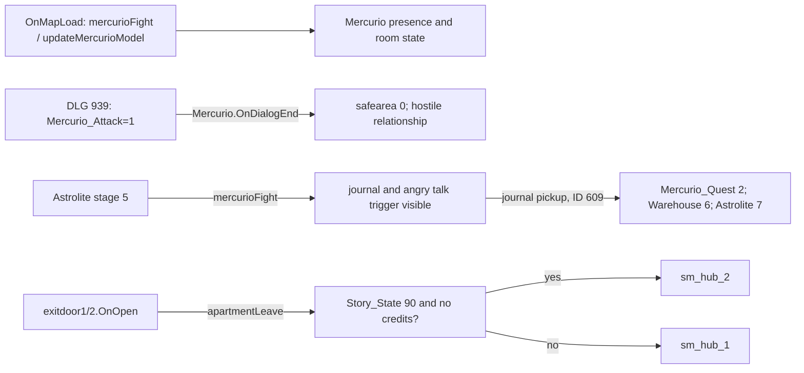

# SM-16.03 — Интерпретация и открытые вопросы

Граф показывает условные вызовы исходников. [INF] Квартира функционирует как повторно посещаемый узел: при изменении `Story_State`, исхода с Mercurio и состояния Carson одна и та же геометрия получает разную популяцию и набор предметов. Это интерпретация кода `finishElysiumTip`, `updateMercurioModel`, `mercurioFight`, а не заявленное намерение авторов.

[INF] Центральный подход с двумя боковыми зонами сначала концентрирует внимание на Mercurio, а затем может направить к компьютеру Carson и вещам по боковым комнатам. Пространственная возможность такого чтения подтверждена геометрией; фактическая последовательность посещений и доступность каждой комнаты требуют проверки дверных состояний. [INF] Два варианта выхода показывают, что даже выход из знакомой квартиры зависит от глобального сюжета, без перестройки самой карты.

## Проверки, оставленные после статического исследования

1. **RUNTIME:** проходимость из центрального подхода в обе боковые зоны, коллизия дверей и условия электронных ручек; нужен движковый тест/BSP-коллизия. План показывает геометрию и сущности, не гарантированный путь.
2. **RUNTIME:** приоритет пересекающихся стартовых условий 1007–1026, группировка ответов и фактическая достижимость поздних DLG-веток; нужен диалоговый движок или наблюдение в игре.
3. **CROSS-LOCATION:** `sm_hub_2.vmf` содержит обратный `ApartmentTeleport1_plus → sm_apartment_1b`, тогда как изучаемый `sm_apartment_1` выходит в `sm_hub_2` при `Story_State==90 && Credits_Running==0`. Условия переключения входа и содержимое `sm_apartment_1b` изучить при работе с hub 2.
4. **OPTIONAL:** сравнить все эффекты 1026 DLG-строк с релизным `mercurio.dlg`, если потребуется каталог изменений UP. Текущая таблица содержит исходные поля без выдуманных соседних переходов.

**Статус: SOURCE COMPLETE / RUNTIME PENDING.** Основные доступные VMF, BSP entity lump, Python, DLG и DATA для Apartment исследованы и связаны. В игре [OBS] не проверялось.
